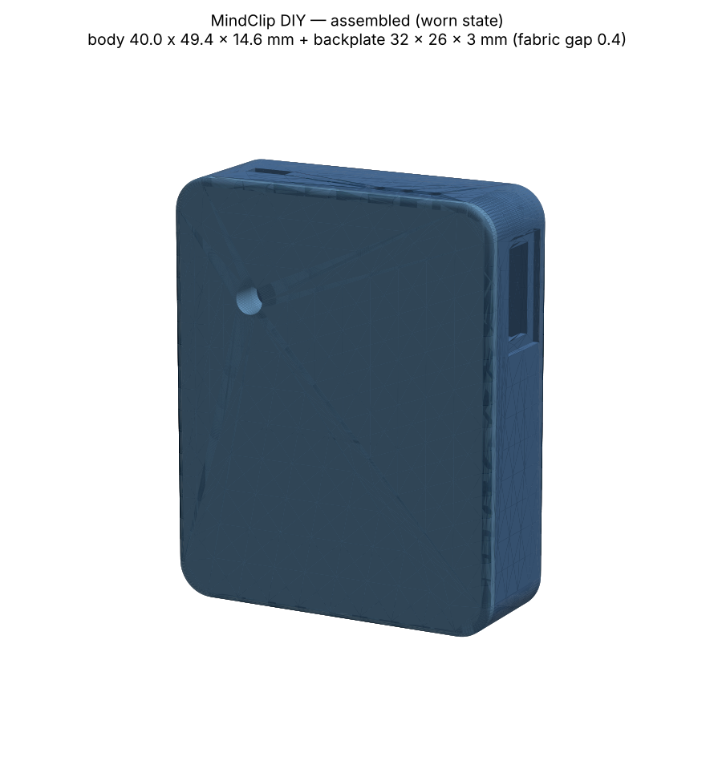
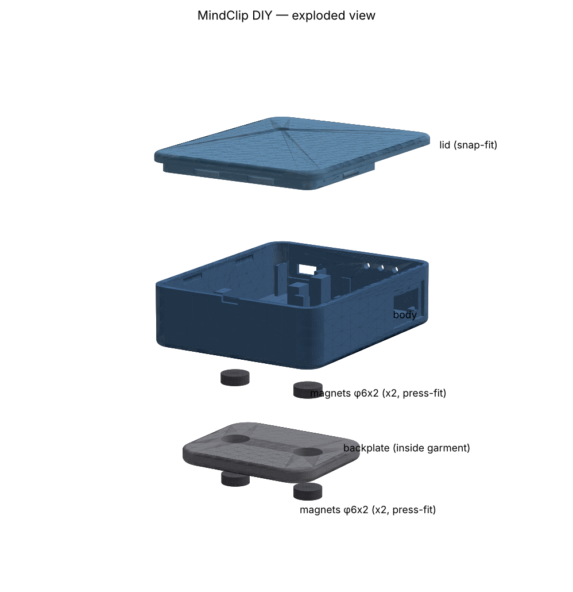
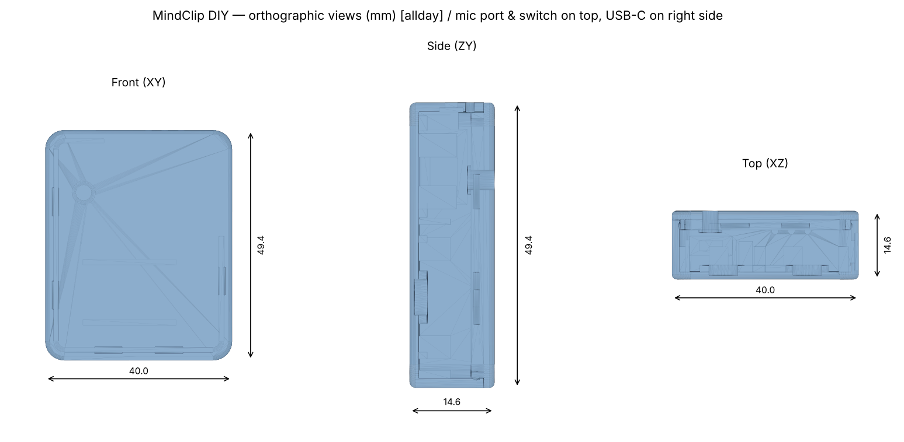
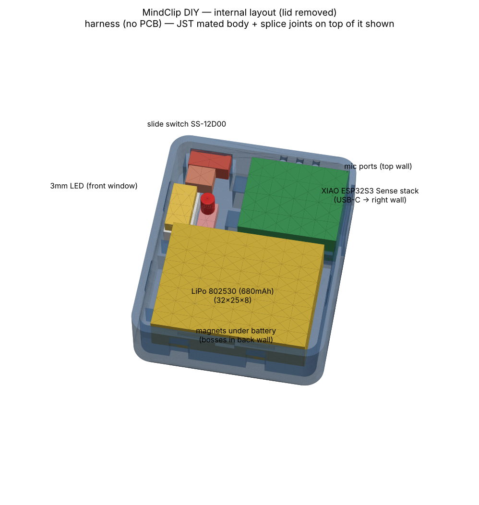

# MindClip DIY — 組み立てガイド（電子工作がはじめての人向け）

自作ウェアラブル音声ロガー **MindClip DIY** のハードウェアを、
**電子工作がまったく未経験の人でも、この手順どおりにやれば組める**ように書いたガイドです。

> **この文書が「正」です。** `ELECTRICAL.md` / `MECHANICAL.md` / `bom.md` と食い違いがある場合は
> このREADMEの記述を優先してください（矛盾していた箇所は各ファイル側も修正済みです）。

---

## 目次

1. [これは何か](#1-これは何か)
2. [完成品の外観](#2-完成品の外観)
3. [バリアントの選び方](#3-バリアントの選び方)
4. [必要な工具一覧](#4-必要な工具一覧)
5. [部品の購入](#5-部品の購入)
6. [3Dプリント手順](#6-3dプリント手順)
7. [組み立て手順](#7-組み立て手順)
8. [動作確認](#8-動作確認)
9. [既知の課題・未検証事項](#9-既知の課題未検証事項)

---

## 0. 最初に読む安全上の注意

作業を始める前に、これだけは頭に入れてください。

- **リチウムポリマー（LiPo）電池は、ショート・逆接続・穴あけで発火します。** 必ず保護回路（PCM）付きを買い、
  被覆を剥いた＋と−のリード線を絶対に触れ合わせないでください（[§7 手順8](#手順8-電池をつなぐjstコネクタ-最重要)）。
- **電池の極性を間違えると、XIAO（¥2,660）は一瞬で壊れます。** 復旧できません。
  v1.5 では電池を **JST コネクタ（電池に付いているプラグと同じ 1.25mm ピッチ 2ピン）で嵌合**する方式に変えましたが、
  **コネクタは「上下逆挿し」しか防いでくれません**（中身の赤黒が逆の個体、
  ハウジング内のコンタクト位置が逆の個体が実在します）。
  **嵌合の前に、テスターで4項目を確認する手順（手順8-B）が唯一の防御です。省略しないでください。**
- **電池のプラグの穴に、テスターの棒・針金・クリップなどの金属を差し込まないでください。**
  1.25mm ピッチのコンタクトは隣どうしが 1mm も離れておらず、金属が斜めに入っただけでショートします。
  電池側の電圧を測るときは、必ず**予備のピグテールを挿して、その線の先で測ります**（[手順5](#手順5-電池ピグテールjstに細い線を継ぎ足すはんだ-2か所)・手順8-B）。
- **電池が繋がっている間は、被覆を剥いた電線の先を2本同時に自由にしない。**
  1本ずつテープで包むか、2本を3cm以上離して机にテープで留めてから作業します。
- はんだごてのこて先は **300℃以上**です。触れると重度のやけどをします。使わないときは必ずこて台に置く。
- はんだの煙は吸わない。**必ず換気**してください（窓を開ける、換気扇を回す）。
- 完成後、**microSDカードやクレジットカード・磁気定期券と密着させて持ち歩かない**でください
  （本機は背面にネオジム磁石を内蔵しています）。

---

## 1. これは何か

MindClip DIY は、襟元にクリップで留めて日常会話を録音し、
そのデータを**自宅のローカルサーバだけ**で文字起こし・要約して Obsidian の Daily Note に貯める、
「外部クラウドに一切データを出さない」音声ライフログデバイスの**自作ハードウェア（Phase 1）**です。
心臓部は Seeed Studio の小型マイコンボード **XIAO ESP32S3 Sense**（マイクとmicroSDスロットが載った拡張ボード付き）で、
外付け部品は **電池・スライドスイッチ・LED（+抵抗）の3つだけ**、はんだ付けは**合計12か所**です
（v1.5 で電池を JST コネクタ化し、空中での3本より合わせを廃止しました。
v1.8 でコネクタ付きコードの太い線を細い線に継ぎ足す 2か所が加わり、10 → 12 になっています）。
システム全体の考え方は [`../docs/local-llm-voice-logger-design.md`](../docs/local-llm-voice-logger-design.md)、
すでに動いている録音ファイル→Obsidian のパイプライン（Phase 0）は [`../voice-logger/`](../voice-logger/) にあります。
**このデバイスのファームウェアは実装済みです** → [`../firmware/`](../firmware/README.md)
（書き込み・WiFi設定・実測ゲートの手順はそちらのガイドにあります）。
本ガイドのゴールは「筐体と回路が正しく組み上がり、マイク・SD・スイッチ・LEDが動くことを確認したうえで、
[§8](#8-動作確認) でファームを焼いて録音〜サーバ同期まで通す」ところまでです。

---

## 2. 完成品の外観

以下は CAD（[`cad/mindclip_case.py`](cad/mindclip_case.py)）が自動生成したレンダリング画像です
（**allday バリアント**のもの。slim は [`renders/slim/`](renders/slim/) にあります）。

| 組み立て状態 | 分解図 |
|---|---|
|  |  |
| 服を挟んで、本体（手前）と裏板（服の内側）を磁石でクランプする | 上から リッド / 本体 / 磁石2個 / 裏板 / 磁石2個 |

| 三面図（寸法入り） | 内部レイアウト |
|---|---|
|  |  |
| 上面にマイク穴とスイッチ、右側面にUSB-C | 下段に電池、上段にXIAO、左にスイッチとLED |

- [`renders/allday/assembled.png`](renders/allday/assembled.png)
- [`renders/allday/exploded.png`](renders/allday/exploded.png)
- [`renders/allday/views.png`](renders/allday/views.png)
- [`renders/allday/internal.png`](renders/allday/internal.png)

配線の全体像は [`wiring.svg`](wiring.svg)（ブラウザで開いてください）が一番わかりやすいです。
**印刷して手元に置きながら作業する**ことを強く勧めます。

---

## 3. バリアントの選び方

筐体CADは **allday** と **slim** の2種類を出力できます。違いは**電池の厚みと、それに伴う筐体の奥行きだけ**です。
回路・配線・はんだ付け・部品点数は完全に同じです。

### allday（既定・**こちらを推奨**）

| 項目 | 値 |
|---|---|
| 電池 | **LiPo 802530（3.7V 680mAh、実測 32.0×25.0×8.0mm・11g、保護回路付き、コネクタは 1.25mm ピッチ 2ピン。採用品: HXJNLDC、[`bom.md`](bom.md) #2）** |
| 外形 | **40.0 × 49.4 × 14.6 mm**（v1.8 実測反映） |
| 印刷部品の重量 | 15.9 g（body 8.2 / lid 4.8 / backplate 2.9） |
| デバイス総重量 | **約35 g**（電池は実測 11g。[§9](#9-既知の課題未検証事項)の注記も参照） |
| 素の状態（省電力実装なし）の連続録音 | **約10.6時間** |
| 生成コマンド | `python3 cad/mindclip_case.py` |

### slim

| 項目 | 値 |
|---|---|
| 電池 | LiPo 502530（3.7V 500mAh、30×25×5.0mm、保護回路付き） |
| 外形 | **40.0 × 49.4 × 13.6 mm**（v1.8 実測反映） |
| 印刷部品の重量 | 15.7 g（body 7.9 / lid 5.0 / backplate 2.9） |
| デバイス総重量 | 約34 g（電池を公称 10g とした見積） |
| 素の状態（省電力実装なし）の連続録音 | 約7.8時間 |
| 生成コマンド | `MINDCLIP_VARIANT=slim python3 cad/mindclip_case.py` |

### なぜ allday を既定にしたか

Seeed公式スペック表に載っている**実測値**「Microphone recording & SD card writing = 3.8V / 平均54.4mA・ピーク108mA」を
電力予算の基準（＝最悪ケース）に置くと、こうなります。

| バリアント | 公称容量 | 実効容量（×0.85） | ÷ 54.4mA |
|---|---|---|---|
| slim | 500mAh | 425mAh | **約7.8時間** |
| allday | 680mAh | 578mAh | **約10.6時間** |

「起床から就寝まで（約15時間）」を目標にすると、**どちらのバリアントも素の状態では届きません**。
allday でも worst case は10.6時間ですが、ファームウェア側の省電力
（CPUクロックを240MHz→80MHzに下げる／SDへの書き込みをRAMにためてまとめ書きする／
無音を検出して書き込みを止める VAD ゲート）で**平均28mAの目標（[§8.7](#87-テスト6-消費電流の実測ゲート必須)）を達成すれば約20.6時間**が見込めます。

そして厚みの増加は **1.0mm だけ**です（14.6mm と 13.6mm）。電池は 5.0mm → 8.0mm と3mm厚くなりますが、
slim の奥行きは XIAO のスタック（基板＋拡張ボード、実測 8.2mm）が決めているので、電池の差がそのまま外形には出ません。
**この1.0mmと引き換えに録音時間が約1.4倍になるので、迷ったら allday** を選んでください。

> **slim を選ぶ理由があるとすれば**: 「とにかく薄くしたい」「会議の1〜2時間だけ使えればいい」場合です。

> **重要な注意（充電時間）**: XIAO の充電電流は **50mA固定**です。680mAh を空から満充電にするには
> **15〜16時間**かかります（500mAhでも11〜12時間）。つまり **一晩（10時間）の充電で戻せるのは約500mAh**。
> allday の 680mAh は「1日にたくさん使うための容量」ではなく、**省電力実装が間に合うまでのマージン・
> 充電し忘れた日の余力・経年劣化代**として効きます。詳しくは [§9](#9-既知の課題未検証事項)。

---

## 4. 必要な工具一覧

「何を買えばいいかわからない」を無くすため、**用途・価格・選び方**をすべて書きます。

### 4.1 これは必ず要る（合計 ¥8,000〜12,000程度）

| # | 工具 | 何に使うか | 目安価格 | 選び方・入手先 |
|---|---|---|---|---|
| T1 | **はんだごて**（30W前後） | 12か所のはんだ付け全部 | ¥1,500〜6,000 | 安く済ませるなら goot KS-30R 等の固定温度30W（¥1,500）。**温度調節付き（白光 FX-600 / ¥6,000前後）だと失敗が激減する**ので、今後も電子工作をするなら最初から温調付きを勧めます。こて先は**細めのB型（φ2mm前後）かC型**。極細（φ0.5）は熱が足りず初心者には難しい。秋月電子・Amazon |
| T2 | **こて台**（クリーニング用スポンジ or ワイヤ付き） | こてを安全に置く／こて先を掃除する | ¥800〜1,500 | 白光 FH-300 など。**「机に直置き」は火事とやけどの原因なので絶対にやらない**。ワイヤ（金だわし）タイプの方がこて先温度が下がらず良い |
| T3 | **はんだ**（φ0.6mm ヤニ入り） | 同上 | ¥800〜1,500 | **初心者は鉛入り（Sn60/Pb40）を強く推奨**。融点が約183℃と低く、格段に扱いやすい。鉛フリーは融点217℃で難易度が上がります。太さは**φ0.6mm**（φ1.0は今回の細かい作業には太すぎ）。作業後は手を洗う |
| T4 | **はんだ吸い取り線**（φ2mm） | **失敗のやり直し**。付けすぎたはんだ、ブリッジ（隣同士がくっつく）の除去 | ¥300〜600 | goot CP-2015 等。**これが無いと失敗がリカバリできません。必ず買ってください** |
| T5 | **ワイヤストリッパ** | AWG28〜30の細い電線の被覆を剥く | ¥1,200〜2,500 | **AWG30まで対応**の表記があるものを選ぶ（例: エンジニア PA-06、ベッセル No.3500E-1）。ニッパーやカッターで剥くと芯線を切ってしまい、後で断線します |
| T6 | **ニッパー**（精密用・小型） | 電線・部品リードの切断 | ¥1,000〜2,500 | HOZAN N-31、フジ矢 等。工作用の大きいニッパーだと細かい所に入りません |
| T7 | **ピンセット**（先の細いストレート） | 小さい部品・電線を押さえる。**熱い部品を触らない**ためにも必須 | ¥300〜1,500 | ステンレス製の先細（No.5型）。100円ショップのものでも可だが、先がぴったり合うものを |
| T8 | **テスター（デジタルマルチメータ）** | **電池の極性確認**（これを怠ると基板が壊れる）／ショートしていないかの導通確認／電圧測定 | ¥1,500〜3,000 | **「導通ブザー機能」と「DC電圧測定」があれば十分**。Amazon の安価品でOK。**この工具だけは省略不可** |
| T9 | **USB Type-C 電流・電圧チェッカー** | [§8.7 の消費電流の実測ゲート](#87-テスト6-消費電流の実測ゲート必須)。充電できているかの確認にも使う | ¥1,000〜2,500 | 「USBテスター Type-C 電流計」で検索。**積算容量（mAh）表示があるもの**が測定に便利 |
| T10 | **USB-Cケーブル**（データ通信対応） | ファーム書き込み・充電 | ¥0〜1,000 | **「充電専用」ケーブルはPCから認識されません。**必ずデータ通信対応品を。手持ち流用可 |
| T11 | **ライター or ヒートガン** | 熱収縮チューブを縮める | ¥100〜3,000 | ライターで可（**炎を直接当てず、横のあぶりで**。当てすぎると溶けて穴が開く）。ヒートガンがあれば確実。**電池のそばではライターを使いません**（手順5の継ぎ目は、はんだごての軸の熱か温風で縮めます） |
| T12 | **耐熱マット or 作業板**（不要な板・タイル等） | 机を溶かさない・焦がさない | ¥0〜1,000 | ダンボールは焦げるので避ける。100円ショップの陶器タイルでも可 |

### 4.2 あると成功率が上がる（推奨）

| # | 工具 | 何に使うか | 目安価格 |
|---|---|---|---|
| T13 | **「第三の手」（ヘルピングツール）** | 基板や電線をクリップで固定する。片手にこて・片手にはんだだと**部品を持つ手が足りない**ので、実質必須に近い | ¥800〜2,500 |
| T14 | **フラックス**（ペーストまたはペン） | はんだの乗りが悪いパッド（XIAO裏面のBATパッドなど）に塗ると劇的に楽になる | ¥500〜1,000 |
| T15 | **ノギス** | 印刷した筐体・買った電池の実寸確認（[§9](#9-既知の課題未検証事項)の未検証項目の検証に使う） | ¥1,000〜2,500 |
| T16 | **針ヤスリ（丸・平）／紙ヤスリ #400** | スナップフィットの嵌合調整、磁石ポケットの微調整 | ¥500〜1,000 |
| T17 | **カッターナイフ・デザインナイフ** | 3Dプリントのバリ取り、糸引きの除去 | ¥300〜800 |
| T18 | **静電気防止リストバンド** | 冬場の基板保護。無い場合は**作業前に金属（ドアノブ等）に触れて放電**する | ¥500〜1,000 |

### 4.3 3Dプリンタ

- **自分で持っている場合**: FDM機（Bambu Lab / Prusa / Ender 等）で十分です。[§6](#6-3dプリント手順)へ。
- **持っていない場合**: STLファイルを外部サービスに投げます。
  - 個人向け: **DMM.make 3Dプリント**、**JLCPCB 3D Printing**（安価だが海外発送）
  - 近所のファブラボ・メイカースペース・図書館のデジタル工房（1時間数百円で使えることが多い）
  - **PETGを指定できるサービスを選んでください**（理由は[§6](#6-3dプリント手順)）。

### 4.4 買い物メモ（最短ルート）

秋月電子で **T1（こて）・T2（こて台）・T3（はんだ）・T4（吸い取り線）・T5〜T7** と[§5](#5-部品の購入)の電子部品をまとめて注文し、
**T8（テスター）・T9（USB電流計）・T13（第三の手）** を Amazon で買うのが手数が少ないです。

---

## 5. 部品の購入

**部品表の正本は [`bom.md`](bom.md) です。** ここでは「買うときにハマりやすい点」だけを説明します。

### 5.1 買い物リスト（要点だけ）

| # | 部品 | 個数 | 目安 | 入手先 |
|---|---|---|---|---|
| 1 | Seeed Studio **XIAO ESP32S3 Sense** | 1 | ¥2,660 | 秋月 通販コード **118079** |
| 2 | **LiPo電池**（バリアントによる。下記5.2） | 1 | ¥900〜1,500 | Amazon 等 |
| 3 | **microSDカード 32GB**（下記5.3） | 1 | ¥800 | Amazon 等 |
| 4 | スライドスイッチ SS-12D00G3 | 1 | ¥20 | 秋月 通販コード **115707** |
| 5 | 3mm 赤色LED（OSR5JA3Z74A） | 1 | ¥10〜20 | 秋月 通販コード **111577** |
| 6 | カーボン抵抗 **220Ω 1/4W** | 1 | ¥200/100本 | 秋月 通販コード **125221** |
| 7 | 配線材 **AWG28**（赤・黒・青・橙。住友電工 イラックスA） | 各20cm以上 | ¥300 | 秋月 通販コード **111640** / 手持ち |
| 8 | 熱収縮チューブ **φ3mm**（φ1.5mm は外径1.5mmの線に通らないので不可） | 1式 | ¥200〜500 | 秋月 通販コード **106789** / Amazon |
| 9 | ポリイミド（カプトン）テープ 幅10mm | 1巻 | ¥500 | Amazon |
| 9a | 薄手両面テープ ＋ 1mm厚スポンジ | 1式 | ¥300〜500 | Amazon / 100円ショップ |
| 9b | **2液エポキシ接着剤** | 1 | ¥300 | ホームセンター / 100円ショップ |
| 9c | ホットボンド or 多用途接着剤 | 1式 | ¥100〜500 | 100円ショップ |
| **A1** | **JST 1.25mm 2ピン コネクタ付きコード（ピグテール／オス・メス組）**。**電池のプラグと同じ系統のもの**（下の注記） | 1組（実際は複数組入りで売られている） | ¥300〜600 | 楽天 / Amazon |
| 10 | ネオジム磁石 **φ6 × 厚2mm** | **4個** | ¥300〜500 | Amazon / 100円ショップ |
| 11 | PETGフィラメント | — | ¥500相当 | — |

**デバイス本体の合計: 約 ¥6,800〜8,100**（工具を除く）。

> **#A1（JST ピグテール）は v1.5 で追加した部品です。** これが無いと
> [手順8](#手順8-電池をつなぐjstコネクタ-最重要) が組めず、v1 の「電池を基板に直はんだ」に
> 逆戻りします。
>
> **【一度まちがえて買っています】** 採用電池（HXJNLDC 802530）のプラグは **1.25mm ピッチの 2ピン**
> （メーカー仕様表の表記は「1.25-2P」）です。最初に買ったピグテール（SONONIA B076SSLHHL）は
> 商品名こそ「1.25mm」でしたが、届いた現物は 2.0mm 系で電池に挿さりませんでした。
> **「1.25mm」と書かれたコネクタには、互いに挿さらない複数の系統があります**（見た目はそっくりです）。
> 現在の購入品は **「JST 1.25mm 15cm 2ピン オス＆メス 20ペア」**（楽天・Coolotic 系）で、
> **電池に挿さるか・嵌合体の寸法（[`MEASUREMENTS.md`](MEASUREMENTS.md) M4）は届いてから確認します（未実測）**。
>
> 買うとき・届いたときの条件:
> 1. **圧着済み（プリクリンプ）品**であること。「コネクタ付きケーブル」「配線済み」の表記のもの。
>    ハウジングと端子だけのセットは圧着工具（¥3,000〜）が要るので買わないこと。
> 2. **オス・メス組**を買う。どちらが電池と嵌合するかは現物を合わせるまで確定しません。
>    余ったほうは、手順8-B の測定用として必ず使います（捨てない）。
> 3. **合格の判定は商品名ではなく現物で行います**: ①電池のプラグの**隣に並べて**、幅・ピンの間隔・
>    ツメの形が同じか見比べる → ②**指先の軽い力で**まっすぐ挿してみる。
>    **軽い力で奥まで入らないものは系統違いです。押し込まない・こじらない**
>    （やり方と注意は [手順5](#手順5-電池ピグテールjstに細い線を継ぎ足すはんだ-2か所) の 5-1）。
> 4. **電線の太さは問いません。** XIAO の裏面には 1.40mm の隙間しかなく、被覆込み外径が 1.3mm を
>    超える線は通せませんが、購入品の線（AWG26 級）は太い可能性があります。
>    そこで v1.8 からは、**ピグテールの線を短く切って細い AWG28（#7）に継ぎ足すのを標準手順**にしました
>    （[手順5](#手順5-電池ピグテールjstに細い線を継ぎ足すはんだ-2か所)）。線の太さで買い直す必要はありません。

### 5.2 【最重要】LiPo電池の買い方

- **必ず「保護回路（PCM / PCB / 保護基板）内蔵」と明記されたものを買ってください。**
  XIAO に載っている充電IC（TI BQ25101）は**充電の制御しかしません**。過放電・過電流・短絡から
  電池を守る回路は入っていないので、**電池側の保護回路が唯一の安全装置**です。
  保護回路なしのセル（ラジコン用の「裸セル」など）を使うと、過放電で電池が死ぬ／最悪発火します。
- **サイズは型番がそのまま寸法です**（例: 802530 = 厚8.0 × 幅25 × 長30 mm。ただし採用品の実測は全長 32.0mm。筐体は 32.0×25.0×8.0 に合わせてあり、**長さ33.0mm・幅25.3mm・厚さ8.5mm を超える個体は入りません**）。
  **容量は型番に含まれません** — 802530 の実容量は約680mAhで、「800mAh」を名乗る 802530 は
  物理的に不可能な密度です（[`bom.md`](bom.md) のエネルギー密度検算を参照）。
  - allday を作る → **802530（680mAh。採用品は [`bom.md`](bom.md) #2 の HXJNLDC）**
  - slim を作る → **502530（500mAh）**
  - **厚みは公称+0.5mmまで**（allday は 8.5mm 超、slim は 5.5mm 超の個体は筐体に入りません）。
- **放電能力**: 連続500mA（1C）以上・瞬時1A程度を許容する保護回路であること。
  WiFi送信時に瞬間的に300mAを超えるためです。市販の一般的な保護回路（2A級）なら通常満たしますが、商品説明を確認してください。
- **【v1.5 必須】コネクタ（プラグ）が付いているもの**を買ってください。
  採用品（HXJNLDC 802530）のプラグは **1.25mm ピッチの 2ピン**です。
  v1 では「コネクタは切り落として使う」と書いていましたが、**この記述は撤回します。**
  v1.5 以降は #A1 のピグテールと嵌合させる前提で、切り落とすと直はんだ（v1）に逆戻りし、
  **充電済みの電池を持ったまま基板にこてを当てる**という一番危ない作業が復活します。
  - **ピグテール（#A1）は「電池に付いているプラグ」に合わせて買います**（逆ではありません）。
    商品説明の「1.25mm」「2.0mm（PH）」「GH」「SH 1.0」「XH 2.5」はすべて別物で、
    **同じ「1.25mm」どうしでも系統が違えば挿さりません**。
    合っているかどうかは、**電池のプラグの隣に並べて見比べ、指先の軽い力で挿さるか**でしか判定できません
    （[§5.1](#51-買い物リスト要点だけ) の #A1 の注記）。
  - **もしバラ線（コネクタ無し）の電池が届いてしまったら**:
    ①返品・交換が最優先。②どうしても使う場合は、**電池側のリードにピグテールを
    はんだ付けする**ことになります（＝充電済みセルへの通電はんだ 2点増。
    必ず1本ずつ・被覆を同時に剥かない・こては2秒以内。**初心者には勧めません**）。
  - 電池に XH(2.5mm) など大きいプラグが付いていた場合、変換ケーブルを買うのは**不可**です
    （嵌合体が高さ8mm あり、筐体の左ポケット（継ぎ目を載せる標準手順での上限 allday 5.9 / slim 4.9mm）に入りません）。
- **買ってはいけない例**: 千石電商 DTP652533（6.5×25×33mm）は**長さ33mmが筐体に入りません**。
- **届いたら真っ先にやること**: テスターのDC電圧レンジで電圧を測り、**どちらのリードが＋か**を確認。
  **中国製セルには赤黒が逆に付いている個体、さらにコネクタのハウジング内で
  コンタクトの位置が逆になっている個体が実在します。**
  **色もコネクタの形も信用しないでください。**
  このガイドでは「セルを嵌合した状態でピグテールの線の先の電圧を測り、＋を示した線を BAT+ に
  はんだ付けする」順序にして、色にもハウジングにも依存しないようにしています
  （[手順5](#手順5-電池ピグテールjstに細い線を継ぎ足すはんだ-2か所) と [手順8](#手順8-電池をつなぐjstコネクタ-最重要)）。
  **電池のプラグの穴にテスターの棒を直接当てて測ることはしません**（ショートの危険。§0）。

### 5.3 【重要】microSDカードの買い方

- **32GB以下**を買ってください。**Seeed公式wikiのサポート上限が32GB**です。
- **FAT32でフォーマット**して使います。32GBまでは出荷時からFAT32なのでそのまま使えます。
- 64GB以上は出荷時 **exFAT** なので FAT32 への再フォーマットが必要ですが、
  **Windows標準機能では32GB超をFAT32にフォーマットできません**（`guiformat` などの外部ツールが要る）。
  初心者は素直に32GBを選んでください。
- Class10 / UHS-I (U1) 以上。SanDisk・Samsung・KIOXIA など素性のわかるメーカー品を。
  極端に安いノーブランド品は容量偽装・書き込み中の脱落があります。

### 5.4 そのほかの注意

- **磁石は「φ6mm × 厚2mm」を4個**。厚3mmや径8mmを買うと筐体のポケットに入りません。
- **接着剤は瞬間接着剤を使わないでください**（磁石とLED窓の固定）。
  瞬間接着剤は硬化時に白い曇り（ブルーム）を出し、**LEDのレンズと窓の内側を曇らせます**。
  また磁石の固定では、剥がすときの引き剥がし方向の力に瞬間接着剤は弱く、磁石が抜けます。**2液エポキシ**を使ってください。
- 抵抗とLEDは袋売り（100本入りなど）になることが多いので、単価と実際の支払額は違います。

---

## 6. 3Dプリント手順

### 6.1 どのファイルを印刷するか

作るバリアントに合わせて、**3つのSTLをすべて1個ずつ**印刷します。
**カバンのショルダーストラップに付けたい場合は、4つ目の strapplate も印刷します**（服に付ける裏板と使い分け。[手順12](#手順12-カバンのストラップに付ける任意)）。

```
allday を作る → stl/allday/mindclip_body.stl
                stl/allday/mindclip_lid.stl
                stl/allday/mindclip_backplate.stl
                stl/allday/mindclip_strapplate.stl   ← カバン用（任意）

slim を作る  → stl/slim/mindclip_body.stl
                stl/slim/mindclip_lid.stl
                stl/slim/mindclip_backplate.stl
                stl/slim/mindclip_strapplate.stl     ← カバン用（任意）
```

> **以前の版の筐体を印刷済みの人へ（v1.8）**: **body（本体）と lid（フタ）は刷り直してください。**
> v1.8 で部品の実測値を反映し、外形の幅が 39.0 → 40.0mm に変わりました（電池の実測 32.0mm、
> USB-C の開口位置、スイッチの高さ）。古い body / lid には電池が入りません。
>
> | 部品 | 以前の印刷物は使えるか |
> |---|---|
> | **body** | **使えない。刷り直し**（v1.8 で幅 +1.0mm。さらに v1.8 rev2 で、マイク穴 3つを XIAO の位置に合わせて 2.0mm 右へ移動・XIAO 右上の角の逃げ・スイッチ右端の位置決めリブを追加。v1.8 の body を刷った人も刷り直し） |
> | **lid** | **v1.7 以前のものは使えない。刷り直し**（幅 +1.0mm。v1.8 の lid は rev2 でも同一データなのでそのまま使える） |
> | **strapplate**（カバン用・任意） | **v1.7 のものは使えない。刷り直し**（本体の幅に合わせてリムが変わった。v1.8 のものは rev2 でも同一） |
> | **backplate**（裏板） | **使える**（最初の版から 1 バイトも変わっていない同一データ） |
>
> LED は allday / slim のどちらも、ドーム先端がフタ面の 0.2mm 内側に沈みます（slim が 0.5mm 出ていたのは v1.7 までの話です）。

STLが無い／パラメータを変えたい場合は、CadQuery 2.8 が入った環境で以下を実行すると再生成されます。

```bash
cd hardware
python3 cad/mindclip_case.py                        # allday（既定）
MINDCLIP_VARIANT=slim python3 cad/mindclip_case.py  # slim
# strapplate を自分のストラップに合わせる（MEASUREMENTS.md の M7 で測った幅・厚み）
MINDCLIP_STRAP_W=32 MINDCLIP_STRAP_T=2.0 python3 cad/mindclip_case.py
```

### 6.2 材料は PETG

**PETG を使ってください。** 理由は3つあります。

- **PLA は不可**: 夏の車内・直射日光下（60℃前後）で軟化して変形します。体温に触れる装着品なので避けます。
- **ABS は反りやすく**、この大きさの薄肉部品では寸法が出にくい（スナップフィットが合わなくなる）。
- PETG は耐熱（ガラス転移温度 約80℃）・靭性ともに十分で、**スナップフィットのたわみに耐えます**。

**色は黒（できればマット）がおすすめです。** 光沢やロゴがないだけで「何かのガジェット」以上には見られにくくなり、
沈めた LED の窓も黒地の中の小さな穴にしか見えません。

### 6.3 推奨スライサ設定

| 項目 | 値 |
|---|---|
| ノズル径 | **0.4 mm** |
| 積層ピッチ（レイヤー高さ） | **0.2 mm** |
| 壁（外周）の周回数 | **4周（= 1.6mm）**（最低でも3周） |
| インフィル（中身の充填率） | **30%**（グリッド or ジャイロイド） |
| ノズル温度 | 235〜245℃（フィラメントの指定に従う） |
| ベッド温度 | 70〜80℃ |
| 印刷速度 | 40〜50 mm/s（小さい部品なので速くしない） |
| 冷却ファン | 30〜50%（PETGは強く冷やすと層間が弱くなる） |
| **サポート** | **3部品とも不要** |
| ブリム | 迷ったら付ける（PETGは反りにくいが、接地面積が小さい lid で保険になる） |
| シーム位置 | 「後方」または「コーナー」に。背面（服に当たる面）に来るようにする |

**壁4周（1.6mm）にする理由**: 筐体の標準壁厚が1.6mmなので、4周にするとインフィルなしの完全ソリッド壁になり、
USB-Cケーブルの抜き差しの力やスナップの繰り返し開閉に対して強くなります。

### 6.4 印刷する向き（重要）

| パーツ | ベッドに接する面 | サポート | 理由 |
|---|---|---|---|
| **body**（本体） | **背面（服に当たる、平らな面）を下に**。開口している側が上を向く | 不要 | 内部のリブがすべて床から立ち上がる形になり自己支持する。USB開口の上辺 約10mm はブリッジになるが、PETGなら問題ない長さ |
| **lid**（フタ） | **外面（表に見える化粧面）を下に**。lip（スカート）と押さえリブが上を向く | 不要 | 表に出る面が一番きれいに出る。スナップリッジは半円断面なので自己支持する |
| **backplate**（裏板） | **肌に当たるフラットな面を下に**（磁石ポケットが上を向く） | 不要 | ベッド面がそのまま肌当たり面になり、最も滑らかに仕上がる |
| **strapplate**（カバン用・任意） | **ストラップに当たる平らな面を下に**（リムと磁石ポケットが上を向く） | 不要 | スロットは縦の貫通穴、ポケットは上が開いた凹みなので、ブリッジもオーバーハングも出ない |

**4つとも（strapplate を含む）「サポートなし」で設計されています。** スライサが自動でサポートを付ける設定になっていたら、**オフにしてください**
（内部にサポートが生成されると、除去できずに部品が入らなくなります）。

### 6.5 印刷前のテスト印刷（強く推奨）

いきなり本体を印刷せず、**まず backplate（裏板・約2.9g・15分程度）だけ印刷**してください。
これで確認できることが2つあります。

1. **磁石が φ6.2mm のポケットに入るか。** FDMの穴は設計値より 0.1〜0.3mm 小さく出ます。
   きつくて入らない場合は、`cad/mindclip_case.py` の `MAG_FIT = 0.2` を **0.3** にして再生成するか、
   丸の針ヤスリでポケットを軽く広げてください。
2. あなたのプリンタの寸法精度そのもの。

### 6.6 印刷後の後処理

- ブリムを付けたら丁寧に剥がし、縁のバリをデザインナイフで取る。
- **body のスナップ受け溝（内壁の水平な半円の溝、左辺2か所・下辺2か所・右辺1か所）**は、
  内部オーバーハングなので表面が荒れます。**丸い針ヤスリで軽くさらって**おくと嵌合が安定します。
- 糸引き（ストリング）はPETGでは出やすいので、ピンセットで取り除く。
- **リッドの嵌め合いを空の状態で確認**します。
  - **きつくて入らない** → `CLR = 0.15` を `0.20` にして再印刷、または lip の外面を紙ヤスリで軽く削る
  - **ゆるくてパチンとしない／すぐ開く** → `CLR` を `0.10` に、または `SNAP_PROTRUDE = 0.3` を `0.4` にして再印刷
  - **初回で一発で決まらないのは想定内です**（[§9](#9-既知の課題未検証事項)参照）。調整を前提に、最初は body と lid だけ刷って試すのも手です。

---

## 7. 組み立て手順

### 7.1 全体の流れ

```
手順1  磁石を接着する（エポキシの硬化に時間がかかるので最初にやる）
  ↓
手順2  XIAO の準備（カメラを外す／拡張ボードの確認）
  ↓
手順3  LEDサブアセンブリを作る          … はんだ 3か所
手順4  スイッチ + GNDデイジーチェーン    … はんだ 2か所
手順5  電池ピグテール(JST)に細い線を継ぎ足す → 極性を測る
                                      … はんだ 2か所（電池は外したまま）
手順6  XIAO に3本の線をはんだ付けする    … はんだ 3か所
  ↓
手順7  【電池を繋ぐ前に】USB給電で動作確認 → §8 のテスト1〜4
  ↓
手順8  ピグテールをXIAOにはんだ付け→テスタゲート→電池を嵌合
                                      … はんだ 2か所（★最重要）
  ↓
手順9  絶縁処理
  ↓
手順10 筐体に組み込む
  ↓
手順11 装着確認
                                      はんだ付け 合計 12か所
```

> **v1.5（構成 A-1）での変更点** — 古い作例と混ざらないように、ここだけ先に押さえてください。
>
> | | v1（旧） | **v1.5（このガイド）** |
> |---|---|---|
> | 電池の接続 | XIAO 裏面パッドへ**直はんだ**（充電済みセルを持ったまま） | **JST コネクタ（1.25mm 2ピン）で嵌合**。基板にはんだ付けするのは**無通電のピグテール** |
> | GND | 黒線3本を空中でより合わせる分岐点（手順5） | **デイジーチェーン**（XIAO GND → スイッチ左端端子 → LED カソード）。**分岐点は廃止** |
> | はんだ | 11か所 | **12か所**（空中3本より合わせ 0か所。v1.5 の 10か所 + **v1.8 で追加したピグテールの継ぎ足し 2か所**） |
> | ピグテールの線 | — | **短く切って細い AWG28 に継ぎ足す**（手順5。太い線は XIAO の下を通せないため、これが標準） |
> | 必須ゲート | （なし） | **手順8-B のテスタ4項目**。1つでも不一致なら嵌合しない |
>
> 正本は [`pcb/SCHEMATIC.md`](pcb/SCHEMATIC.md) §1.4（はんだ点）と §5（電池系）です。

### 7.2 はんだ付けの基本（未経験の人はここを先に読む）

はんだ付けは「はんだをこてで溶かして垂らす」作業では**ありません**。
**部品と配線を先に温めて、そこにはんだを触れさせて吸い込ませる**作業です。

**基本の4ステップ**

1. こての温度を **320〜350℃**（鉛入りはんだの場合）にして、こて先に少量のはんだを乗せる（＝こて先メッキ）。
2. **こて先を「はんだ付けしたい2つのもの（例: パッドと電線）」の両方に同時に当てて 1〜2秒温める。**
3. そのまま**はんだを、こて先ではなく温めた部分に**当てる。スッと溶けて流れ込む。
4. はんだを離し、**その0.5秒後にこてを離す**。冷えるまで（2〜3秒）動かさない。

**良いはんだ付け**: 富士山のようななだらかな裾を持つ、光沢のある形。
**悪いはんだ付け（イモはんだ）**: 球状に盛り上がって光沢がない。→ 温度不足か、温めずにはんだだけ垂らした証拠。
吸い取り線で取り除いてやり直します。

**練習を勧めます。** 余った電線同士を3〜4回つないでみてから本番に入ってください。捨てる部品で練習するのが一番の近道です。

**共通のリカバリ方法**

| 症状 | 対処 |
|---|---|
| はんだが盛りすぎ／隣とくっついた（ブリッジ） | **はんだ吸い取り線（T4）**を患部に当て、その上からこてを押し当てる。はんだが吸い取り線に吸われる |
| はんだが玉になって乗らない | 温度不足かパッドの酸化。フラックス（T14）を塗り、こてを1〜2秒長く当てる |
| 電線が抜けた | 芯線を撚り直し、予備はんだをしてからやり直す |
| 部品を焦がした・溶かした | 部品は数十円なので**迷わず新品に交換**する（特にスライドスイッチは熱で樹脂が溶けて接点がずれる） |

### 手順1: 磁石を接着する

**必要なもの**: 印刷したbody・backplate、ネオジム磁石4個、2液エポキシ、マスキングテープ、つまようじ

1. **極性合わせが最重要です。** 4個の磁石を「本体用2個」「裏板用2個」に分けます。
   紙を1枚挟んで、**引き合う（くっつく）向き**の組み合わせを作り、上を向いている面にマスキングテープで
   印（本体側は「B」、裏板側は「P」など）を付けます。
   **左右2組とも同じ向きに揃えてください。片方だけ逆だと反発して固定できません。**
2. 2液エポキシを混ぜ、つまようじでポケットの底に少量塗ります。
3. body の磁石ポケット（電池が載る床、丸いボスの上面に開いている2つの穴）に、印を上にして磁石を押し込みます。
   **磁石の上面がポケットの縁より沈むこと**（面一以下）を確認してください。飛び出していると電池が浮きます。
4. backplate も同様に、**磁石ポケットが開いている側**（服に当たる側）から押し込みます。
   反対側（肌に当たる面）は完全にフラットです。
   - **裏板側は特に接着を丁寧に。** 服から外すときに磁石を引き剥がす方向の力がかかるので、
     接着が甘いと磁石だけ抜けます。ポケット底面にしっかり接着剤を行き渡らせてください。
5. **硬化を待ちます**（5分硬化型でも実用強度までは30分〜数時間、説明書に従う）。この間に手順2〜6を進めます。

> **やってはいけないこと**: 瞬間接着剤の使用（引き剥がし力に弱く、硬化ガスで筐体内が白く曇る）。
> 磁石をポケットから飛び出させて接着すること（電池が浮いてリッドが閉まらなくなる）。

### 手順2: XIAO の準備

1. XIAO ESP32S3 Sense の箱には、**メイン基板**と**Sense拡張ボード**（マイクとmicroSDスロットが載った板）、
   そして**カメラモジュール**（フレキシブルケーブル付き）が入っています。
2. **拡張ボードは、はんだ付け不要です。** メイン基板の裏にある B2B コネクタ（黒い小さなコネクタ）に、
   位置を合わせて**まっすぐ「カチッ」と押し込むだけ**です。斜めに押すとピンが曲がります。
   - **向きに注意**: 拡張ボードは**部品面（USB-Cコネクタがある側）に**装着します。
     結果として、**BAT+/− のはんだパッドがある面が「裏面」**になります。
3. **カメラは使いません。** 拡張ボードの白いコネクタのラッチを起こして、フレキケーブルを抜き、
   カメラモジュールを取り外してください（そのままだと厚みが増えて筐体に入りません）。
   外したカメラは静電気防止袋に入れて保管を。
4. microSDカードを拡張ボードのスロットに挿しておきます（[§8](#8-動作確認) のテストで使います）。
5. **基板の端子部分（金色の部分）に素手で触らない**でください。作業前に金属に触れて静電気を逃がします。

### 手順3: LEDサブアセンブリを作る（はんだ 3か所）

LED は**フタ（lid）側に接着**され、配線で本体側の XIAO と繋がります。
フタを開け閉めするたびに配線が引っ張られるので、**配線は長めに取ります**。

**用意するもの**: 3mm赤色LED × 1、220Ω抵抗 × 1、橙の電線・黒の電線
（**allday は各 60mm / slim は各 45mm**。剥き代を入れて +5mm で切ってください）、熱収縮チューブ

> **電線の長さは「長ければ安心」ではありません。** slim は左ポケットの空きが 約1.6cm³ しかなく、
> 60mm のままだと充填率が約 50%（実用上限 50〜60% の入口）に掛かって、
> **最後にフタが閉まらない**という一番タチの悪い失敗になりやすくなります。
> slim では 45mm にしてください（充填率 約46%。そのぶんフタの開き角は狭くなります）。
> allday は 60mm で余裕があります（充填率 約44%）。

> **【重要】黒の電線は両端がはんだ付けで塞がります。**
> この黒線は「LEDのカソード」と「スイッチの左端端子」を直接つなぐ線です（v1.5 のデイジー
> チェーン。v1 にあった空中の分岐点はありません）。
> **太めの熱収縮チューブ（φ3mm、20mm長）を、はんだ付けを始める前に必ず通しておいてください。**
> 後からは絶対に通りません。

> **220Ωの見分け方**: カラーコードが **赤・赤・茶・金**（2 → 2 → ×10 → ±5%）です。
> 不安ならテスターの抵抗レンジで測って 209〜231Ω の範囲にあることを確認してください。

> **LEDの足の見分け方**: **長い足＝アノード（A、＋側）**、**短い足＝カソード（K、−側）**。
> 足を切ってしまった場合は、LEDの樹脂を覗いて**中の金属板が大きい方がカソード**、
> または**樹脂のフチが平らに削られている側がカソード**です。

1. **【はんだ #7a】220Ω抵抗の片方の足 ← 橙の電線**
   - **何を・どこに**: 抵抗の片足と、被覆を4mm剥いた橙の電線を繋ぐ。
   - **コツ**: 抵抗の足を電線にフック状に1回巻き付けてから、はんだを流す。**先に橙の電線に熱収縮チューブ（φ2〜3mm、15mm長）を通しておく**（はんだ付け後には通せません）。
   - **間違えると**: この線が後で XIAO の D3 に繋がります。順番自体を間違えることはありません。
2. **【はんだ #7b】220Ω抵抗のもう片方の足 ← LEDの長い足（アノード）**
   - **何を・どこに**: 抵抗の残った足を、LEDの**長い足**に繋ぐ。足同士を絡めてはんだ付けし、余った先はニッパーで切る。
   - **コツ**: **こてを当てる時間は3秒以内**。LEDは熱に弱く、長時間熱するとチップが死にます。ピンセットで足の付け根を挟んでおくと放熱器代わりになります。
   - **★間違えると何が起きるか**: **抵抗を入れ忘れて GPIO と LED を直結すると、電流が制限されずに LED と XIAO の GPIO ピンが壊れます。**
     この抵抗は「無くても光るが、あとで壊れる」部品ではなく、**必須の保護部品**です。
     また、**LEDの短い足（カソード）側に抵抗を繋いでしまっても回路的には動作します**が、本ガイドの配線図（wiring.svg）はアノード側なので、揃えてください。
3. **【はんだ #8】LEDの短い足（カソード）← 黒の電線**
   - **何を・どこに**: LEDの**短い足**に、黒の電線（allday 60 / slim 45mm）を繋ぐ。
     **上の囲みのとおり、φ3mm の熱収縮チューブを先に通しておくこと。**
     この線の反対側の端は、手順4でスイッチの左端端子に付きます。
   - **コツ**: 同じく3秒以内。
   - **★間違えると何が起きるか**: **アノードとカソードを逆に繋ぐと、LEDは光りません**（壊れはしませんが、原因究明で時間を溶かします）。
     動作確認で光らなかったら、まずここを疑ってください。
4. 熱収縮チューブを継ぎ目の上にスライドさせ、ライターの炎の**横**であぶって縮めます。
   **抵抗の胴体と、はんだの継ぎ目が金属剥き出しにならない**ように覆ってください。
5. LEDの足を、**根元から2〜3mmのところで90度に曲げます**（フタの裏に沿わせるため）。
   - **曲げる向きが決まっています: 電池のある側（下向き＝筐体のy−方向）へ曲げてください。**
     反対（XIAO 側）へ曲げると、本体側の「XIAO 左ストップリブ」に当たります。
   - 曲げたリードと 220Ω が占める帯は、CAD 上で **x8.2–11.8 / y28.6–37.6** として
     確保してあります（`renders/allday/pcb_pocket.png` の赤い点ハッチ）。
     **左側の JST コネクタ（x1.6–7.4）とは 0.8mm しか離れていません。**
     リードを左（JST 側）へ曲げないでください。

### 手順4: スイッチ + GNDデイジーチェーン（はんだ 2か所）

**用意するもの**: SS-12D00 スライドスイッチ × 1、青の電線 50mm、黒の電線 50mm、
手順3で作ったLEDサブアセンブリ（黒線の空いている側を使います）、熱収縮チューブ、ニッパー

スイッチには端子が**3本**ありますが、**使うのは「中央」と「左端」の2本だけ**です。

> **【先にやること】未使用の右端の端子を、根元から切り落としてください。**
> 「右」とは、スイッチを筐体に入れたときに **XIAO 側（筐体の x+ 方向）**に来る端子です。
> 残したままだと、はんだと熱収縮チューブの外形が右へ約 2.5mm 広がり、
> **スイッチ右端の位置決めリブまで 0.5mm** しか残らず、電池の線を XIAO の下へ通す道
> （[手順10](#手順10-筐体に組み込む) の図の x11.8〜14.4）も狭くなります
> （CADの `sw_terms` は「中央＋左端の2本だけを使う」前提で干渉検査しています）。
> 向きが分からなくなったら、レバーを上に・端子を手前にして、**部品面から見て右側**の1本です。

1. **【はんだ #6a】スイッチの中央端子 ← 青の電線（50mm）**
   - **コツ**: 端子には小さな穴が開いています。被覆を3mm剥いた電線を穴に通して軽く折り返してから、はんだを流すと確実です。
     **こてを当てるのは2〜3秒以内**（長いとスイッチの樹脂が溶けて、中の接点がずれて動かなくなります）。
   - **★間違えると何が起きるか**: **中央ではなく端の端子に繋ぐと、スイッチをどちらに倒しても状態が変わらず、録音のON/OFFができません。**
2. **【はんだ #6b】スイッチの左端の端子 ← 黒の電線 2本**
   - **何を・どこに**: ①これから XIAO の GND ピンへ行く黒線（50mm）と、
     ②手順3のLEDカソードから来ている黒線（allday 60 / slim 45mm）の**2本**を、
     **左端の端子1か所**にまとめてはんだ付けします。
     これが v1.5 の **GNDデイジーチェーン**（XIAO GND → スイッチ端子 → LED カソード）で、
     v1 にあった「空中で黒線3本をより合わせる分岐点」を無くしたぶんに当たります。
   - **★やり方が決まっています（ここを外すと必ずやり直しになります）**:
     **2本の芯線を先に撚り合わせる → 撚った束に予備はんだをする → 端子へ一度で流す。**
     **1本ずつ後から足そうとすると、先に付けた線が溶けて外れます**（初心者が最も
     繰り返しやすいループです）。こては2〜3秒以内。
   - はんだ付け後、**手順3で通しておいたφ3の熱収縮チューブを継ぎ目まで滑らせて縮めます**。
3. どちらが「録音ON」になるかは、**レバーを黒線を繋いだ端子の側（左）に倒したとき**です
   （その位置で中央と端が導通する＝GPIO2がGNDに落ちる＝ON）。
4. **テスターで3項目チェックします**（後から気づくと組み直しになります）:
   - **ON位置**: 中央端子 ↔ 左端端子 が**導通する**
   - **OFF位置**: 中央端子 ↔ 左端端子 が**導通しない**
     （ここが導通したままだと、GPIO2が恒久LOW＝**常時録音でdeep sleepに入らず、半日で電池が空**になります。
     v1.5 唯一の同期トリガである「スイッチOFF」も死にます）
   - **目視**: 中央端子と左端端子の**はんだがブリッジ（くっついて）いない**こと。
     左端は黒線2本ぶんのはんだが乗るので、v1 よりブリッジ確率が上がっています。
     くっついていたら吸い取り線（T4）で除去してやり直し。

### 手順5: 電池ピグテール（JST）に細い線を継ぎ足す（はんだ 2か所）

**用意するもの**: #A1 の JST 1.25mm 2ピン ピグテール（オス・メス組。複数組あるので失敗してもやり直せます）、
AWG28 の電線（#7。**赤 55mm・黒 55mm**）、φ3mm の熱収縮チューブ（#8。**10mm に切ったものを 2個**）、
LiPo電池（**袋に入れたまま。5-7 まで出しません**）、ニッパー、ワイヤストリッパ、はんだごて、
テスター、マスキングテープ、ノギス

> **この手順でやること**: ピグテールの線は太くて XIAO の下（すきま 1.40mm、通せるのは外径 1.3mm まで）を
> 通せない可能性があるので、**コネクタのすぐ先で短く切り、細い AWG28 に継ぎ足します**（これが標準手順です）。
> そのあと電池を一度だけ挿して、どちらの線が＋かを測ります。
>
> **安全の約束（3つだけ）**
> 1. **切る・剥く・はんだ付けするのは、電池に繋がっていないピグテールだけ。**
>    5-2〜5-6 の間、電池は袋の中です。**電池側のプラグや線には一切手を加えません。**
> 2. **電池を挿している間（5-7）は、線の先を2本とも机にテープで留めておく。**
>    被覆を剥いた先が2本、自由に動ける状態を一瞬も作りません。
> 3. **電池のプラグの穴に金属（テスター棒・針金）を入れない。**

**5-1. 電池に合うのがオス・メスどちらか確かめる（合わないコネクタを見抜く）**

1. 電池を袋から出し、プラグを机に置きます。ピグテールのオス・メスを**プラグの隣に並べて見比べ**ます。
   挿さる相手は、**幅・2本のピンの間隔（1.25mm）・ツメ（出っ張り）の形**がプラグと対になっているほうです。
   - 並べただけで明らかに大きい・ピンの間隔が広い → **系統違い**です（最初に買った 2.0mm 系がこれでした）。
     挿さずにここで止めて、[§5.1](#51-買い物リスト要点だけ) の #A1 の注記に戻ってください。
2. 挿す前に、**そのピグテールの2本の線の先を、1本ずつマスキングテープで包みます**
   （工場出荷の状態で先端の金属がむき出しになっている品が多いためです。2本まとめて包まないこと）。
3. **指先の軽い力で、まっすぐ**挿してみます。
   - **軽い力で奥まで入り、ツメが掛かる → 合格**。これが「使う側」です。
   - **途中で止まる・斜めにしか入らない・力が要る → 系統違いです。絶対に押し込まない・こじらない。**
     無理に入れるとコンタクトが曲がり、プラグの中でショートします。
4. 合格したら**すぐに抜いて**（線ではなく樹脂の部分を持ってまっすぐ）、**電池を袋に戻します。**
   使わなかった側（電池のプラグと同じ形のほう）は**手順8-B の測定に使うので取っておきます。**

**5-2. 線を切る（ここから 5-6 まで、電池は袋の中）**

- 使う側のピグテールの2本の線を、**コネクタの根元から測って 1本は約10mm、もう1本は約15mm** のところで切ります。
  - **わざと長さを変えます。** 2つの継ぎ目の位置が 5mm ずれるので、万一チューブが破れても
    継ぎ目の金属どうしが触れ合いません。
  - **これより長く残さないでください**（15mm を超えない）。継ぎ目は硬い塊になり、置ける場所が
    コネクタの真上しかありません（[手順10](#手順10-筐体に組み込む) の図）。

**5-3. 熱収縮チューブを先に通す**

- **φ3mm・長さ10mm のチューブを、AWG28 の赤と黒に 1個ずつ通しておきます。**
  はんだ付けのあとでは通せません（反対側の端から入れることはできますが、忘れるのが一番多い失敗です）。
  はんだの熱で縮まないよう、**継ぐ端から 3cm 以上離れた位置**まで寄せておきます。
  （φ1.5mm のチューブは、外径 1.5mm 前後のピグテールの線には通りません。φ3mm を使います）

**5-4. 【はんだ #9・#10】ピグテールの線 ← AWG28**

- ピグテール側の線と AWG28 の両方の被覆を **3mm** 剥き、芯線をそれぞれ撚ります。
- 2本を**同じ向きに 3mm 重ねて**（突き合わせではなく重ねる）、はんだを流します。こては 2〜3秒。
  - ピグテールの**赤い線に赤の AWG28、黒い線に黒の AWG28** を継ぐと後で見やすくなります。
    **ただし色は目印にすぎません。どちらが＋かは 5-7 の測定だけで決めます**
    （赤黒が逆の個体が実在します。§5.2）。
- はんだが尖っていたら、ニッパーで角を落とすか、こてでなでて丸めます（チューブを破らないように）。

**5-5. チューブを縮める（電池のそばで火を使わない）**

- チューブを継ぎ目の真ん中まで滑らせ、**はんだごての軸（先端ではなく、根元寄りの金属の筒の部分）を
  1〜2mm まで近づけてあぶる**か、ドライヤー・ヒートガンの温風で縮めます。
  - **この手順ではライターを使いません。** 同じ机に充電済みの電池があります。
  - 縮んだあと、**チューブの両端から金属が見えていないこと**を確かめます。
    見えていたらチューブを切り取り、新しいチューブでやり直します（反対側の端から通せます）。
- できあがりは「コネクタ → 10mm と 15mm の位置に継ぎ目（太さ約2.5mm・長さ約10mm）→ 細い線 約50mm」です。
  **コネクタの根元から線の先までは 約60mm と 約65mm** になります。これ以上長くしないでください
  （slim では左ポケットに入る配線の量に上限があり、**フタが閉まらなくなります**）。

**5-6. 線の先を「測れる状態」にして、机に固定する（まだ電池は袋の中）**

1. AWG28 の2本の先を **2mm だけ**剥きます（長く剥かない）。
2. **剥いたらすぐ、1本ずつ**マスキングテープを二つ折りにして先端を包みます（旗のような形になります）。
3. 机の上（**金属の定規や工具が近くに無い、木や紙の面**）にピグテールを置き、
   **2本の線を「ハ」の字に開いて、先端どうしを 3cm 以上離し**、それぞれ先端から 1cm 手前を
   マスキングテープで机に貼り付けます。**引っ張っても動かないこと**を確かめます。
4. コネクタの近くも 1か所テープで留めます（挿すときに線が跳ねないように）。

**5-7. 極性を測る（★このガイドで一番大事な測定。電池を挿している時間は 1分以内）**

1. テスターを **DC電圧（20V）レンジ**にして、プローブを手元に置きます。
2. 電池を袋から出し、ピグテールに**指先の軽い力でまっすぐ**挿します。
3. **机に固定したまま**、2本の先端のテープの旗を外します（線は動かさない。固定してあるので触れ合えません）。
4. 2本の先端にプローブを1本ずつ当てます。
   **+3.5〜4.2V と出たら、赤プローブを当てているほうの線が「＋」**です。
   （**−3.5〜−4.2V** と出たら、黒プローブを当てているほうが「＋」です。）
   - 0V のまま → プローブが芯線に当たっていないか、嵌合が浅いか、継ぎ目のはんだ不良です。
     **電池を抜いてから**調べます。
5. **＋と判定された線に、マスキングテープで「＋」と書いた印を2か所**（コネクタの近くと、先端の近く）付けます。
   **線の色は記録するだけで、判断には使いません。**
6. 嵌合したまま、**ノギスで嵌合体（挿し合わさったコネクタ全体）の 長さ・幅・厚み を測ってメモ**します
   （[`MEASUREMENTS.md`](MEASUREMENTS.md) の M4。樹脂の外側だけを挟み、金属ノギスなら線の先に触れないこと）。
   - **合格: 厚み allday 5.9mm / slim 4.9mm 以下、長さ 11.1mm 以下、幅 5.8mm 以下。**
     超えていたら筐体の CAD を直す必要があるので、手順10 に進む前に相談・再生成してください。
7. **電池を抜きます**（樹脂の部分を持ってまっすぐ）。**袋に戻します。**
8. **電池を抜いてから**、先端をもう一度 1本ずつテープで包み、机のテープを剥がします。
   ここから先、電池は手順8-B の④まで触りません。

> **もし 5-7 の途中で線が外れて動いたら**: 何よりも先に**電池を抜いて**ください。直すのはそのあとです。

### 手順6: XIAO に3本の線をはんだ付けする（はんだ 3か所）

XIAO の基板の縁には、片側7個ずつ、計14個の小さな穴（スルーホール）が並んでいます。
**ピンヘッダは使いません**（高さが増えて筐体に入らないため）。**電線を直接、穴にはんだ付けします。**

**ピンの位置**（USB-Cコネクタを上にして基板を部品面から見たとき）:

```
          [ USB-C ]
   D0  ○           ○  5V
   D1  ○ ←青       ○  GND ←黒
   D2  ○           ○  3V3
   D3  ○ ←橙       ○  D10
   D4  ○           ○  D9
   D5  ○           ○  D8
   D6  ○           ○  D7
```

**必ず基板に印刷された文字（シルク）で D1 / D3 / GND を確認してください。**

1. **下準備（予備はんだ）**: D1・D3・GND の3つの穴に、こてを当ててごく少量のはんだを流し、穴を埋めます。
2. **【はんだ #3】D1 ← 青の電線**（スイッチの中央端子から来ている線）
   - **やり方**: 電線の被覆を3mm剥き、芯線をねじって予備はんだをする。予備はんだした穴にこてを当ててはんだを溶かし、
     そこに電線を差し込んでからこてを離す。
   - **★間違えると何が起きるか**: **隣の D0 や D2 とはんだがくっつく（ブリッジ）と、ショートして誤動作、
     最悪は基板が壊れます。** はんだ付け後に必ず**テスターの導通ブザーで「D1とD0」「D1とD2」が導通していないこと**を確認してください。
     別のピンに付けてしまった場合はファームの設定と合わなくなるだけなので、吸い取り線で外してやり直せば済みます。
3. **【はんだ #4】D3 ← 橙の電線**（220Ω抵抗から来ている線）
   - 同上。**D2 / D4 とのブリッジを確認。**
4. **【はんだ #5】GND ← 黒の電線**（手順4でスイッチの左端端子に付けた 50mm の線）
   - **GNDは 5V と 3V3 の間**にあります。
   - **★間違えると何が起きるか**: **隣の 5V や 3V3 とブリッジすると電源が短絡します。**
     USBを挿した瞬間にPCのUSBポートの保護が働く（あるいは基板が壊れる）ので、**ここは特に念入りに導通確認**してください。
5. **全体チェック**: 通電前に、テスターの導通ブザーで以下を確認します。
   - GND と 5V が**導通していない**こと
   - GND と 3V3 が**導通していない**こと
   - D1 と D0/D2 が**導通していない**こと
   - D3 と D2/D4 が**導通していない**こと
   - スイッチをONにしたとき、**D1 と GND が導通する**こと（＝配線が正しく繋がっている証拠）

### 手順7: 【電池を繋ぐ前に】動作確認をする

**ここで一度、[§8 動作確認](#8-動作確認) のテスト1〜4を実施してください。**

電池を繋いでしまうと、以下が起きたときに手戻りが大きくなります。

- 配線の間違いが見つかっても、電池が付いていると作業中のショートリスクが跳ね上がる
- LEDの極性ミス・スイッチの向き違いを直すのに分解が必要になる

**電池はまだ触りません。** USBケーブルだけで XIAO は動きます。

### 手順8: 電池をつなぐ（JSTコネクタ） ★最重要

> **この手順は、このガイドで唯一「一度間違えたら復旧できない」ステップです。**
> 落ち着いて、飛ばさずに全部読んでから作業してください。

**★間違えると何が起きるか**: **＋と−を逆に繋ぐと、3.7Vが逆向きに印加されて、
XIAO の充電ICと電源回路が一瞬で壊れます。煙が出ることもあります。修理は不可能で、基板（¥2,660）の買い直しです。**

このガイドでは、この手順を **「無通電のピグテールを基板にはんだ付けする」→「テスタで4項目確認する」
→「最後に電池を嵌合する」** の3段に分けています。
**電池が繋がっていない状態ではんだ付けするので、こてを当てている間に壊れることはありません。**
壊れるとしたら「間違えたまま嵌合した瞬間」だけです。だから**嵌合の前のゲートが全て**です。

**手順8-A: ピグテールを XIAO にはんだ付けする（はんだ 2か所・無通電）**

1. **USBケーブルを抜きます。電池も繋ぎません**（電池は袋の中。ピグテールには何も挿さっていないこと）。
2. XIAO 裏面の BAT+ / BAT− の**両方のパッドに予備はんだ**をします（ごく少量、盛り上げすぎない）。
   パッドが小さいので、フラックス（T14）を塗ってからやると格段に楽です。
   - パッドの向き: **Seeed公式wikiによれば、−（マイナス）が USB-Cコネクタに近い側、
     ＋（プラス）が遠い側**です。**必ず基板のシルク印刷を目視で確認してください。**
     読めない場合は、読めるまで作業を進めないでください。
3. **【はんだ #1】手順5-7 で「＋」の印を付けた線 → BAT+ パッド**
4. **【はんだ #2】もう一方の線 → BAT− パッド**
   - **線の色ではなく、手順5-7 で付けた印で判断します。**
   - 線の先はテープの旗を外して使います（剥いてあるのは 2mm。足りなければ 3mm まで剥き足す）。
   - **2本の電線を基板の裏で重ねないこと。** 逃げ空間は 1.40mm しかありません。
     左右に振り分けて1層に敷き、はんだ盛りは低く抑えます
     （重ねると基板が浮き、USB-Cが開口とずれて充電できなくなります）。
   - **継ぎ目（熱収縮チューブの太い部分）は XIAO の下に入れません。** XIAO の下を通るのは細い AWG28 だけです。

**手順8-B: 【必須ゲート】テスターで4項目を確認する（省略禁止）**

> **このゲートが安全の全てです。** 1つでも合わなければ**嵌合しないでください。**
> （設計上の根拠は [`pcb/SCHEMATIC.md`](pcb/SCHEMATIC.md) §5.4）
>
> **測り方の約束**: コネクタの中の金属（コンタクト）にテスターの棒を直接当てることはしません。
> 小さすぎて当たらないうえ、**電池のプラグでそれをやるとショートします。**
> 代わりに、**予備のピグテールを挿して、その線の先で測ります。** 用意するのは次の2本です。
>
> - **予備O**: 手順5-1 で「使わなかった側」（＝**電池のプラグと同じ形**のほう）。未加工のまま 1本。
> - **予備M**: 手順5 で加工したのと**同じ側**の、未加工のもの 1本（複数組入りなので余りがあります）。
>
> どちらも、線の先を**1本ずつ**マスキングテープで包んでから使います。

**①〜③の準備（電池は使いません。USBケーブルも抜いたまま）**: XIAO に付いているピグテール（以下「本番のコネクタ」）に、**予備O** を挿します。
挿した状態で机に置くと、線は2本ずつ**まっすぐ向かい合います**。**同じ列（同じ側）にある線どうしが、中で繋がっています。**
予備O の線の先のテープを外し、テスターを**導通レンジ**にします。

| # | 測定 | 期待値 | 合わないときは |
|---|---|---|---|
| ① | 予備O の線のうち、本番の**「＋」印の線と同じ列にあるほう** ↔ XIAO 裏面 **BAT+ パッド** | **鳴る** | はんだ不良か付け間違い。やり直す |
| ② | 予備O の**もう一方の線** ↔ XIAO の **GNDピン** | **鳴る** | 鳴らない場合は BAT− と GND が内部で繋がっていない個体です。[`pcb/SCHEMATIC.md`](pcb/SCHEMATIC.md) §5.3 に従い、設計側の確認が要るので**先に進まないでください** |
| ③ | 予備O の**2本の線どうし** | **鳴らない**（数十kΩ以上） | ショートしています。吸い取り線で除去してやり直す |
| ④ | **電池の＋が、本番のコネクタの「＋」印の線と同じ位置に出てくるか**（下記。予備M を使う） | 一致 | **下の「④が合わなかったら」へ** |

①〜③が済んだら、**予備O を抜きます。**

**④のやり方（手順5-7 の測定を、別のピグテールでもう一度やって照合する）**:

1. **本番のコネクタと予備M を机に並べます。** どちらも**ツメ（出っ張り）のある面を上、線を手前**に向けます。
   本番のコネクタで、**「＋」印の線が左から出ているか右から出ているか**を見て、紙に「本番: ＋は左（または右）」と書きます。
2. 予備M の2本の線を、手順5-6 と同じように**「ハ」の字に開いて 3cm 以上離し、机にテープで固定**します
   （先端のテープの旗はまだ付けたまま）。
3. テスターを DC電圧レンジにします。**電池を袋から出して予備M に挿し**（指先の軽い力でまっすぐ）、
   先端のテープを外して電圧を測ります。**+3.5〜4.2V と出たとき赤プローブ側の線が＋**です。
4. **電池をすぐ抜いて袋に戻します。** そのあとで、予備M の＋だった線が
   **（ツメを上・線を手前にして）左か右か**を見ます。
5. **予備M の＋の位置と、1 で書いた本番の「＋」印の位置が同じなら合格**です。
   - **リード線の色は一切見ません。** 見るのは「ツメを基準にした左右の位置」だけです。
     赤黒が逆の個体だけでなく、**ハウジングの中でコンタクトが左右逆に入っている個体**が
     実在します。色ではなく位置で比べるのはそのためです。
   - **手順5-7 を正しくやっていれば、④は必ず一致します**（同じ電池の同じ極性を、別のピグテールで測っているだけなので）。
     **一致しないときは、どちらかの測定か印が間違っています。手順5-7 と④の両方をやり直してください。**
   - **電池のプラグの穴に、テスターの棒や針金を差し込んで測ってはいけません**（旧版の手順は撤回しました。
     1.25mm ピッチではコンタクトどうしが近すぎ、金属が斜めに入っただけでショートします）。

**④が合わなかったら（やり直しても本番の「＋」印が逆だったら）**:

- **電池側は絶対に触らないでください**（充電済みセルのプラグや線に手を加える作業は危険です）。
- 直すのは**ピグテール側**です。**電池が繋がっていないことを確かめてから**、
  XIAO の BAT+ / BAT− パッドに付けた2本の線を吸い取り線で外し、**＋と−を入れ替えてはんだ付けし直します**
  （手順8-A に戻る。無通電なので安全です）。印も付け直し、**①〜④をもう一度全部やり直します。**
  - コネクタのハウジングから金具（コンタクト）を抜いて入れ替える方法は、このガイドでは使いません
    （1.25mm のコンタクトは小さく、抜くときに曲げると接触不良やショートの原因になります）。
- **中止条件**: ②が鳴らない／④が何度やっても一致しない／予備のピグテールが電池に軽い力で挿さらない場合は、
  **そこで作業を止めてください。**
  電池を嵌合してよいのは、①〜④が全部揃ったときだけです。

**手順8-C: 電池を嵌合する**

5. USBケーブルを抜いたまま、電池を本番のコネクタに**指先の軽い力で、ツメが掛かるまでまっすぐ挿します**（斜めに挿さない・力を入れない）。
6. XIAO の赤いLEDの挙動を確認します（USBを挿すと**充電中は点滅**、満充電で消灯）。
7. **以後、電池の付け外しはコネクタで行えます。** 筐体の嵌合調整でフタを刷り直すときも、
   電池をはんだ付けし直す必要はありません（これが v1.5 でコネクタ化した最大の利点です）。

### 手順9: 絶縁処理

1. XIAO裏面の BAT+/− のはんだ部分を、**ポリイミド（カプトン）テープで覆います**。
   はんだの尖った部分が電池のパウチを突き破ると、発火します。
2. **電池の本体と、XIAOの基板裏面の間にも、カプトンテープを1枚貼ります**（絶縁と穿孔防止の二重化）。
3. 手順3〜5で作った熱収縮チューブが、すべての金属継ぎ目を覆っていることを目視で確認します。
   特に **スイッチ左端端子（黒線2本の継ぎ目）** は、はんだが盛られていて筐体の
   リブや電池に一番近づく場所です。**手順5 のピグテールの継ぎ目 2か所**も、チューブの両端から
   金属が見えていないかもう一度見ます。

### 手順10: 筐体に組み込む

> **【先にやること】部品を入れる前に「空の筐体で1回フタを閉める」練習と、
> JSTコネクタの仮置き確認をしてください。**
> JST嵌合体の寸法（CAD の確保寸法 5.8 × 11.0 × 4.5mm）は**仮の値**です。購入した 1.25mm 品の実寸は
> 手順5-7 で測った値（[`MEASUREMENTS.md`](MEASUREMENTS.md) M4）で、**厚み（寝かせたときの高さ）が
> allday 5.9mm / slim 4.9mm 以下、長さが 11.1mm 以下、幅が 5.8mm 以下**なら今の筐体に入ります。
> そのうえで、**嵌合体を左ポケットの床（下の図の位置）に置き、継ぎ目2つをその上に載せて、フタを1回閉めてみます。**
> ここは CAD の自動チェックでは守れず、実機でしか判定できない唯一の関門です。
>
> ```
>   左ポケットを上（フタ側）から見た配置 — 単位 mm、左下が原点（CAD の出力値）
>
>     y47.8 ─ 上の壁（内面）─────────────────
>           │  スイッチ本体  x4.0-12.7 / y44.5-48.5    │ ← 右端の位置決めリブ x13.0-13.8
>     y44.5 ├───────────────────┤
>           │ (スイッチ端子 + 熱収縮)                   │    x4.2-10.0 / y40.0-44.5
>     y40.0 ├─────────┬─────────┤    ↑ JST の上端とのすきまは 0.4mm
>     y39.6 │ JST     │         │
>           │ 嵌合体   │ LED 本体 │    JST    : x1.6-7.4 / y28.6-39.6 / 床から高さ 4.5
>           │ (寝かす) │ +リード  │             （左内壁に密着・長辺を縦に）
>           │ ＋その   │         │    継ぎ目 : JST の真上 x1.9-6.9 / y28.9-39.3
>           │ 真上に   │         │             床から 4.8〜7.3 の高さ（2本並べて寝かす）
>           │ 継ぎ目2つ│         │    LED    : 本体 x8.2-11.4（窓中心 x9.8, y36.0）
>     y28.6 └─────────┴─────────┘             リード帯 x8.2-11.8 / y28.6-37.6
>          x1.6      x7.4 x8.2  x11.8    x14.4 (XIAOストップリブの左面)
>                     └0.8┘      └─ 2.6 ─┘
>                  埋めない      細い線の通り道（何も置かない）
>
>   XIAO ストップリブ: x14.4-17.25 の 2本（y31-35 と y40-44）。
>   その**切れ目 y35-40 が、細い線が XIAO の下へ入る唯一の入口**です。
> ```
>
> **継ぎ目（太さ約2.5mm × 長さ約10mm の硬い部分）を置いてよいのは「JST嵌合体の真上」だけです。**
> コネクタの口から出た線を**すぐ折り返して**、嵌合体の背中に2本並べて寝かせます。次の2か所には絶対に入れません:
> - **XIAO の下**（すきまは 1.4mm。継ぎ目が入ると基板が浮き、USB-C が開口とずれて充電できなくなります）
> - **ストップリブの切れ目（x14.4〜17.25 / y35〜40）**（入口を塞ぐと線が噛み、同じく基板が浮きます）
>
> 継ぎ目から先の細い線（AWG28）は、LED のリードの上を右へ渡し → x11.8〜14.4 の通り道を通って →
> リブの切れ目から XIAO の下へ入ります。

1. **スイッチを本体に固定**します。
   body の**上面の内側**にある浅い凹み（深さ0.7mm）にスイッチ本体をはめ、
   レバーが上面のスロット（5.0×2.2mm）から突き出ることを確認します。
   スイッチの左右にある 2本の位置決めリブ（右側は v1.8 rev2 で追加）の間に収まります。
   リブとのすきまは左右 0.3mm ずつで、凹みとリブで位置が決まり、接着剤が固定します。
   位置が決まったら**ホットボンドまたは多用途接着剤で固定**します（エポキシでも可）。
   - **注意**: レバーの動きが接着剤で固まらないよう、**接着剤は本体の底面側だけに**付けます。
2. **LEDをフタ（lid）に接着**します。
   1. **先に、フタの外面（化粧面）の LED の穴を、外側からマスキングテープで塞ぎます**（しっかり密着させる）。
      LED と穴のすきまは 0.2mm しかなく、エポキシが毛細管現象で外側まで回ります。テープが無いと、
      **フタが机に貼り付く・LED のドームに接着剤が付いて曇る**という、やり直しのきかない失敗になります。
   2. **フタを外面（テープを貼った面）を下にして、平らな机の上に伏せます。** 内側に立っている**短い筒（スリーブ）**に、
      **内側からLEDを挿し込み**、**ドームの先端がテープ越しに机に当たるまで**そっと押し込みます。
   3. その姿勢のまま、**筒の口と LED の根元の境目にだけ、つまようじの先で少量の**エポキシを付けて固まるまで待ちます
      （流し込まない。多いと筒の中を伝って外面まで出ます）。
   4. 完全に固まってから、フタを起こしてテープを剥がします。
   - これで先端がフタの面とほぼそろいます（テープの厚みぶん、0.1mm ほど内側に入ります）。
   - v1.8 の実測で、秋月の OSR5JA3Z74A はツバが φ3.4mm × 厚0.5mm と細く、窓の穴（φ3.4）とほぼ同じでした。
     ツバだけでは止まらない個体があるため、**机に当てて止める**方法にしています。ツバから先端までは実測 4.5mm で設計どおりです。
     （CAD は LED が 0.2mm 奥にある場合で干渉を検査しています。机に当てて止めると LED はそれより
     フタ側に付くので、リードは CAD の想定より下がりません。）
   - **入らない場合**: FDMの穴は 0.1〜0.3mm 小さく出ます。3.0mm のドリルか丸の針ヤスリ（T16）で、
     **内側から**軽くさらってください（外側は化粧面なので触らない）。
   - **窓の位置は v1.4 から 2.9mm 右へ移動しています。** 古い lid（LED窓が左寄り）を
     印刷済みでも使わないでください。窓の下に JST コネクタが来てしまい、
     曲げたLEDリードとぶつかります（[§6.1](#61-どのファイルを印刷するか) 参照）。
   **2液エポキシ**で固定します（瞬間接着剤はレンズが白く曇るので不可）。
   - 硬化するまでは次に進めないので、先にこれをやってから3以降を進めてもOKです。
3. **電池を入れます。**
   - **左端のストップリブに突き当てて**置きます（allday は右壁との間に **2.4mm の隙間が残るのが正解**です。slim は電池が 2mm 短いので 4.4mm。ここはフタの右ツメが降りてくる通り道なので、隙間を詰めようとして右に寄せないでください）。
   - **★この隙間は、フタの右側の lip（スカート）が入ってくる通り道です。何も詰めないでください。**
     allday では、電池の右端と lip のすきまは **1.25mm** です。電池がそれだけ右にずれるとフタが閉まらなくなります
     （電池の個体差でも減るので、「左に突き当てたまま固定」を守ってください。[§9.10](#910-電池の位置決めに右方向のストッパーがない)）。
   - 磁石が入っているボスと支持リブの上に載る形になります。**薄手両面テープで底面を固定**します。
   - **リード線は電池の左端面から出ています。** 左端の 2.4mm のチャネル（溝）を上に回して、
     電池の上の隙間から XIAO の下の空間へ通します。
   - **リード線・テープ・スポンジが電池の上面より高く飛び出さない**ようにしてください
     （allday なら底から11.0mm、slim なら8.0mmが上限。ここを超えるとフタの lip とぶつかります）。
4. **XIAOスタックを入れます。**
   - 4隅のコーナーシート（床から1.4mm立ち上がった座面）の上に載せます。
     **この1.4mmの空間が、裏面のはんだ盛りとカプトンテープの逃げ場**です。
   - **基板の右端を右の内壁に当てて**、USB-Cコネクタが右側面の開口にぴったり合う位置にします。
     左側のストップリブとの間に収まります。
   - **薄手両面テープで固定します。これは必須です。**
     USB-Cケーブルを挿す力（規格上5〜20N）で基板が動くと、コネクタが開口からずれて充電できなくなります。
   - アンテナのフィルム（付属のWiFiアンテナ）は、**左の側壁の内面**に貼ります。
     場所は **電池より上の区画（JST とスイッチがある左ポケット）の左の壁、y28〜47 の範囲**で、
     高さは **床から 5mm より上・壁の上の縁（フタが載る面）から 2.5mm より下の帯**です
     （床から 5mm までは JST コネクタが壁に付く場所、縁から 2.2mm はフタの lip が入る場所。
     帯の幅は allday で約4mm・slim で約3mm）。
     - フィルムが帯より大きくて入らない場合は、**スイッチの真下の床（x2〜14 / y40〜47）**に貼ります。
     - **貼ってはいけない場所**:
       - **上の壁（スイッチとマイク穴がある壁）の内面** — 旧版はここも可としていましたが撤回します。
         **マイクの穴3つ（上の壁の x24.0 / 27.5 / 31.0、床から 8〜9.5mm の高さ）を塞いでしまいます。**
       - 右の壁（USB-C の開口 y33〜43.6 がある）／フタの内面（LED と電池押さえリブがある）
       - 電池に重なる場所（電池と壁・電池とフタに挟まれる場所）、XIAO の下
     - **貼ったあとの確認: 外から上面を見て、マイクの穴3つが全部ふさがっていない（穴の奥が見通せる）こと。**
     - フィルムの実寸は未実測です。貼る前に仮置きして、フタが閉まることも確認してください。
5. **JSTコネクタ（嵌合体）を置いて固定します。**
   - **左の内壁にぴったり寄せて、長辺を縦（上下方向）にして寝かせます。**
     位置は上の図のとおり（x1.6–7.4 / y28.6–39.6）。**電池から来る線が出ている口を下（電池側）、
     継ぎ足した線が出ている口を上（スイッチ側）**に向けます。**横向きに寝かせてはいけません**
     （LED のリードに重なり、細い線の通り道も塞ぎます）。
   - **薄いほうの面を上下にして（厚みが高さになる向きで）寝かせてください。**
     立てて置くと、slim では上に載せる継ぎ目がフタの縁（lip）に当たります。
   - **ホットボンドを「左の内壁との間に1点だけ」**付けて固定します。盛りすぎない。
   - **継ぎ目2つを、嵌合体の真上に載せます。** 上の口から出た線をすぐ手前（フタ側）へ折り返し、
     2本を横に並べて嵌合体の背中に寝かせ、マスキングテープかカプトンテープで嵌合体ごと 1周巻いて留めます
     （ホットボンドで埋めない。あとで電池を外せなくなります）。
     **継ぎ目が嵌合体の上端（スイッチ側）より先へはみ出さないこと**（はみ出すとスイッチの端子に当たります）。
   - 継ぎ目から先の細い線は、図の「通り道」（x11.8〜14.4）→ リブの切れ目（y35〜40）→ XIAO の下、の順に通します。
     **線が長くて余るぶんは、XIAO の下ではなく通り道の側でたるませます。**
   - **ケーブル側も1か所固定します**（電池の上面などにテープで軽く留める）。
     コネクタは常に振動にさらされるので、**ケーブルを引っ張る力が嵌合部にかからない**
     ようにするためです（抜けかけると録音中にリセットしてファイルが壊れます）。
6. **配線を整理します。**
   LEDから来ている配線の余長を、電池の脇の空間に押し込みます。コイル状にまとめると収まりが良いです。
   - **電池の上（電池室）では、配線・テープ・スポンジを電池上面より高くしない**
     （allday は底から11.0mm、slim は8.0mmが上限）。
   - **左ポケット（JSTとLEDのある側）では、天井まで使ってかまいません**（ただし継ぎ目の置き場所は 5 のとおり嵌合体の真上だけ）。
     ただし**フタの左スカート（lip）が下りてくる帯（左の壁から 0.15〜1.15mm の幅）**
     には何も入れないでください。
   - **slim で「フタが閉まらない」ときは、配線の詰めすぎがほぼ原因です。**
     LED側の余長を45mmに切り詰めたか確認してください。
7. **フタを閉めます。**
   閉める順番があります: **①上辺の左コーナーのスタブ（出っ張り）を引っかける → ②左辺を差し込む → ③下辺を押してパチンと入れる。**
   - **無理に押し込まないでください。** 硬い場合は、配線を噛んでいないか・電池が右にずれていないか・
     継ぎ目が嵌合体の上からずれて LED の筒やフタの縁の下に入っていないかを先に確認します。
   - **開けるとき**は、底面の中央にある**こじ開けノッチ**（小さな切り欠き）に爪を掛けて手前に起こします。

### 手順11: 装着確認

1. backplate（裏板）の**磁石が入っている面を、本体側に向けて**、服（襟元・胸ポケットの縁など）を挟みます。
2. 上下に軽く揺すって、ずり落ちないことを確認します。
3. **落ちる場合**: 生地が厚すぎます。[§9](#9-既知の課題未検証事項) のフォールバック（φ6×3mm磁石への変更）を検討してください。

### 手順12: カバンのストラップに付ける（任意）

**必要なもの**: 印刷した strapplate、ネオジム磁石2個（裏板とは別に追加）、2液エポキシ、マスキングテープ

磁石クリップ（裏板）は布越しの磁力で留めるので、厚さ3〜5mmのストラップでは磁力が届かず留まりません。
strapplate は**ストラップを板のスロットに編み込んで固定し、本体はその板に磁石で直接くっつける**方式です。
本体と板の間に布が無いので、裏板より強く吸着します。**板はストラップに付けっぱなしにして、夜は本体だけ外して充電**します。

0. **先に自分のストラップを測ります**（[`MEASUREMENTS.md`](MEASUREMENTS.md) の M7）。既定は **幅38mm以下・厚さ2.5mm以下** 用です（幅は環境変数で **39.6mm まで**広げられます。それより広いストラップは本体幅 40.0mm の都合で不可）。
   違う場合は [§6.1](#61-どのファイルを印刷するか) のコマンドで作り直してから印刷します。
   **ストラップの片端を外せること**（長さ調整バックル側から抜ける）が条件です。両端が縫い付けで外せないストラップには付けられません。
1. **磁石の向きを決めます**（手順1の磁石が硬化した後に行う）。新しい磁石を1個、**本体の背面の磁石の位置に置く**と、
   壁越しに吸い付きます。**見えている面（本体と反対側）にマスキングテープで「下」と印**を付けます。もう1個も同様に。
2. エポキシをポケット底に少量塗り、**「下」の印をポケットの底に向けて**押し込みます。板の上面より沈むこと（面一以下）。
   これで、本体に吸い付いていた面が上を向くので、必ず引き合います。硬化を待ちます。
3. **ストラップを編み込みます**（図: `renders/allday/strapplate.png` の右側）。
   板の平らな面をストラップに当て、**磁石がある側を下**に向けます。ストラップの端を
   **裏から上のスロットに通す → 中央の細いバーの上（リムのある側）を通す → 下のスロットから裏へ戻す**、の順に通し、平らに引き伸ばします。
   バックルに通し直して長さを戻せば完了です。S字に曲がった摩擦で、板はストラップ上をずり落ちません。
4. **本体を載せます**。リムの右側の切り欠きと本体の USB-C 口を合わせて押し込むと、磁石で吸い込まれます。
   USB-C の位置が合っていないと（上下逆）磁石が合わず保持できないので、**切り欠き＝USB-C の位置**を目印にしてください。
5. 上下・左右に軽く揺すって、外れないことを確認します。外すときは本体をまっすぐ手前に引きます。

---

## 8. 動作確認

ここでやるのは、**①ハードウェアが正しく組み上がっているか**を短いテストプログラムで1つずつ確かめ、
続いて **②MindClip 本体のファームウェア（Phase 1）を焼いて実際に録音・同期まで通す**作業です。
**必ずこの順番で**、前のテストが通ってから次に進んでください。

| テスト | 内容 | 何を確かめるか |
|---|---|---|
| [テスト1](#82-テスト1-lチカ外付けledが光るか) | Lチカ | LED・220Ω・GNDデイジーチェーンの配線 |
| [テスト2](#83-テスト2-スイッチ入力の読み取り) | スイッチ | D1(GPIO2)の配線とスイッチ端子の選択 |
| [テスト3](#84-テスト3-microsdカードへの読み書き) | microSD | 拡張ボードの嵌合とカードのフォーマット |
| [テスト4](#85-テスト4-マイクの録音) | マイク録音 | PDMマイクと筐体のマイク開口 |
| [テスト5](#86-テスト5-ファームウェアの書き込みと通し確認) | **本体ファーム** | 書き込み・WiFi設定・録音〜サーバ同期の通し |
| [テスト6](#87-テスト6-消費電流の実測ゲート必須) | **消費電流ゲート** | 平均 ≤28mA（**筐体を量産印刷する前の必須条件**） |
| [テスト7](#88-テスト7-充電の確認) | 充電 | 50mAで充電されているか |

> **MindClip 本体のファームウェアは実装済みです** → [`../firmware/`](../firmware/README.md)。
> テスト1〜4 は「そのファームを焼く前に、ハード単体の切り分けを済ませておく」ためのものです。
> ここを飛ばすと、動かなかったときに原因がハードかソフトか分からなくなります。

### 8.1 Arduino IDE のセットアップ

1. [Arduino IDE 2.x](https://www.arduino.cc/en/software) をインストールします。
2. **ファイル → 基本設定 → 追加のボードマネージャのURL** に以下を追加します。
   ```
   https://espressif.github.io/arduino-esp32/package_esp32_index.json
   ```
3. **ツール → ボード → ボードマネージャ** で「esp32」を検索し、**esp32 by Espressif Systems（3.x系）**をインストールします
   （数分〜十数分かかります）。
4. **ツール → ボード → esp32 → 「XIAO_ESP32S3」** を選択します。
5. **以下の設定を必ず確認**してください（ここを間違えると「動かない」の原因になります）。

   | 設定項目 | 値 | 理由 |
   |---|---|---|
   | **USB CDC On Boot** | **Enabled** | これが Disabled だと、**シリアルモニタに何も表示されません**。テスト2以降で必須 |
   | **PSRAM** | **OPI PSRAM** | Sense拡張ボードのマイク・SD処理で使う |
   | Flash Size | 8MB (64Mb) | |
   | Upload Speed | 921600（不安定なら 115200 に下げる） | |

   > **この表の設定は、テスト用スケッチだけでなく MindClip 本体のファームにもそのまま必要です。**
   > とくに **PSRAM = OPI PSRAM** は既定が `Disabled` で、無効のまま焼くと本体ファームの録音バッファが
   > 60秒 → **5秒に縮退**し、省電力要件（[`ELECTRICAL.md`](ELECTRICAL.md) §2.2 の要件2）を満たせません。
   > 設定の詳細と理由は [`../firmware/README.md`](../firmware/README.md) §2.2 にあります。

6. USB-Cケーブル（**データ通信対応品**）でXIAOとPCを繋ぎ、**ツール → ポート**で認識されたポートを選びます。
   - **ポートが出てこない場合**: XIAOの「B（BOOT）」ボタンを押しながらUSBを挿す（または B を押しながら R（RESET）を押して離し、最後に B を離す）と、
     ブートローダーモードで強制認識させられます。書き込み後に一度 R（RESET）を押してください。
   - それでもダメなら**ケーブルが充電専用**の可能性が高いです。別のケーブルを試してください。

### 8.2 テスト1: Lチカ（外付けLEDが光るか）

**確認できること**: D3（GPIO4）の配線、220Ω抵抗、LEDの極性、GNDデイジーチェーン
（XIAO GND → スイッチ左端端子 → LEDカソード）が繋がっていること。

> XIAO には基板上のユーザーLEDもありますが、そのピン（GPIO21）は **microSDのCS信号と共用**なので、
> このプロジェクトでは状態表示に使えません。**外付けLEDを付けたのはこれが理由**です。

```cpp
// test1_blink.ino — 外付けLED(D3)を1秒周期で点滅させる
const int LED_PIN = D3;   // GPIO4

void setup() {
  pinMode(LED_PIN, OUTPUT);
}

void loop() {
  digitalWrite(LED_PIN, HIGH);
  delay(500);
  digitalWrite(LED_PIN, LOW);
  delay(500);
}
```

**期待する結果**: 外付けの赤色LEDが1秒周期で点滅する。

**光らないときの切り分け**

| 確認 | 対処 |
|---|---|
| LEDの向き | 長い足（アノード）が抵抗側、短い足（カソード）が黒線側か。**逆だと光りません** |
| はんだ付け | D3・GNDのはんだ、抵抗の両端、スイッチ左端端子の黒線2本をテスターの導通ブザーで確認 |
| 電線の断線 | 被覆の中で芯線が切れていることがある。線を軽く引きながら導通を見る |
| ブリッジ | D3が隣のD2/D4とくっついていないか |

> **応用**: `analogWrite(LED_PIN, 30);` に置き換えると「微灯」になります（実運用ではこの明るさを使います）。

### 8.3 テスト2: スイッチ入力の読み取り

**確認できること**: D1（GPIO2）の配線、スイッチの端子選択（中央＋片端）、内部プルアップの動作。

```cpp
// test2_switch.ino — スライドスイッチの状態をシリアルに出し、LEDに反映する
const int SW_PIN  = D1;   // GPIO2
const int LED_PIN = D3;   // GPIO4

void setup() {
  Serial.begin(115200);
  pinMode(SW_PIN, INPUT_PULLUP);   // 内部プルアップ: 何も繋がっていないとHIGH
  pinMode(LED_PIN, OUTPUT);
}

void loop() {
  bool recording = (digitalRead(SW_PIN) == LOW);   // ON = GNDに落ちる = LOW
  digitalWrite(LED_PIN, recording ? HIGH : LOW);
  Serial.println(recording ? "REC ON  (switch = LOW)" : "REC OFF (switch = HIGH)");
  delay(300);
}
```

**期待する結果**: **ツール → シリアルモニタ**（ボーレート 115200）を開き、
スイッチのレバーを動かすと表示が `REC ON` / `REC OFF` に切り替わり、LEDも連動して点灯・消灯する。

**うまくいかないときの切り分け**

| 症状 | 原因 |
|---|---|
| ずっと `REC ON` のまま | スイッチの**中央端子と左端端子のはんだがブリッジしている**（[手順4](#手順4-スイッチ--gndデイジーチェーンはんだ-2か所) の4番の検査を飛ばした）／D1とGNDがブリッジしている |
| ずっと `REC OFF` のまま | 中央端子ではなく**端の端子2つ**に繋いでいる／D1かGNDの線が断線・未接続 |
| シリアルモニタに何も出ない | **USB CDC On Boot が Enabled になっていない**（[§8.1](#81-arduino-ide-のセットアップ)） |

**この時点で、レバーのどちら側が「録音ON」かをメモしておいてください。** 筐体に組み込むと確認しづらくなります。

### 8.4 テスト3: microSDカードへの読み書き

**確認できること**: 拡張ボードがB2Bコネクタに正しく刺さっているか、SDカードのフォーマット、SPI配線（拡張ボード内蔵なので配線作業はなし）。

```cpp
// test3_sd.ino — microSDをマウントし、ファイルを書いて読み返す
#include "FS.h"
#include "SD.h"
#include "SPI.h"

void setup() {
  Serial.begin(115200);
  delay(2000);                       // シリアルモニタを開く時間をかせぐ

  if (!SD.begin(21)) {               // CS = GPIO21
    Serial.println("SD mount FAILED");
    return;
  }
  Serial.printf("SD size: %llu MB\n", SD.cardSize() / (1024ULL * 1024ULL));

  File f = SD.open("/mindclip_test.txt", FILE_WRITE);
  if (!f) { Serial.println("open for write FAILED"); return; }
  f.println("hello mindclip");
  f.close();

  File r = SD.open("/mindclip_test.txt");
  Serial.print("read back: ");
  while (r.available()) Serial.write(r.read());
  r.close();
  Serial.println("SD test OK");
}

void loop() {}
```

**期待する結果**: シリアルモニタに容量が表示され、`hello mindclip` が読み返され、`SD test OK` が出る。

**`SD mount FAILED` のときの切り分け**

| 確認 | 対処 |
|---|---|
| カードが挿さっているか | 「カチッ」と奥まで押し込む |
| フォーマット | **FAT32** でフォーマットし直す。exFATではマウントできません |
| 容量 | **32GB以下**か（公式サポート上限） |
| 拡張ボード | B2Bコネクタが**斜めに刺さっていないか**。一度抜いて、まっすぐ押し直す |
| カード自体 | PCで読み書きできるか確認。安価なノーブランド品は初期不良も多い |

### 8.5 テスト4: マイクの録音

**確認できること**: PDMマイク（拡張ボード上）の動作と、SDへの書き込みの組み合わせ。

以下は Seeed公式wikiのサンプル（ESP32ボードパッケージ 3.x系の `ESP_I2S` ライブラリ）に沿ったものです。
**コンパイルが通らない場合は、Arduino IDE の「ファイル → スケッチ例 → ESP_I2S」および
Seeed公式wikiの最新サンプルを優先してください**（ライブラリAPIはコアのバージョンで変わります）。

```cpp
// test4_mic.ino — PDMマイクで10秒録音し、SDに rec10s.wav として保存する
#include <ESP_I2S.h>
#include "FS.h"
#include "SD.h"

I2SClass I2S;

void setup() {
  Serial.begin(115200);
  delay(2000);

  I2S.setPinsPdmRx(42, 41);          // CLK = GPIO42, DATA = GPIO41（拡張ボード内蔵）
  if (!I2S.begin(I2S_MODE_PDM_RX, 16000, I2S_DATA_BIT_WIDTH_16BIT, I2S_SLOT_MODE_MONO)) {
    Serial.println("I2S init FAILED");
    return;
  }
  if (!SD.begin(21)) { Serial.println("SD mount FAILED"); return; }

  Serial.println("recording 10s ...");
  size_t wav_size = 0;
  uint8_t *wav = I2S.recordWAV(10, &wav_size);
  if (wav == nullptr || wav_size == 0) { Serial.println("record FAILED"); return; }

  File f = SD.open("/rec10s.wav", FILE_WRITE);
  f.write(wav, wav_size);
  f.close();
  Serial.printf("wrote %u bytes to /rec10s.wav\n", (unsigned)wav_size);
}

void loop() {}
```

**期待する結果**: 10秒間しゃべった内容が `/rec10s.wav` に保存される。
SDカードをPCに挿して再生し、**自分の声が聞き取れるか**を確認します。

**ここで必ず確認すること（筐体を確定する前の重要な検証）**

- **筐体に組み込んだ状態で録音してみてください。** 上面のマイク穴（φ1.5mm × 3個）を通した音が
  十分な大きさで録れるかどうかは、**まだ実測されていません**（[§9](#9-既知の課題未検証事項)）。
- 明らかに音が小さい・こもる場合は、`cad/mindclip_case.py` のマイク開口を **φ1.5 → φ2.0** に変更して
  印刷し直すのが第一の対策です（`body` の中で `makeCylinder(0.75, ...)` の `0.75` を `1.0` にする）。

### 8.6 テスト5: ファームウェアの書き込みと通し確認

**確認できること**: MindClip 本体のファーム（[`../firmware/mindclip/`](../firmware/)）が書き込めること、
WiFi・サーバの設定がデバイスに入ること、**録音 → スイッチOFF → サーバへ同期**が最後まで通ること。

> **詳しい手順は [`../firmware/README.md`](../firmware/README.md) にあります**（書き込み・プロビジョニング・
> トラブルシューティングを1手順ずつ書いた専用ガイドです）。ここでは流れと合格条件だけを示します。

**手順の流れ**

1. **サーバ側を先に用意します**（デバイスに入れる証明書と共有鍵をサーバ側で作るため）。
   `voice-logger` を入れて、プライベートCA・サーバ証明書・デバイス証明書・HMAC鍵を作り、`voice-logger serve` を起動します
   （[`../voice-logger/README.md`](../voice-logger/README.md) の「デバイス受信API」節）。
2. **ボード設定を確認します**（[§8.1](#81-arduino-ide-のセットアップ)）。**PSRAM = OPI PSRAM**、**USB CDC On Boot = Enabled** が必須です。
3. `firmware/mindclip/mindclip.ino` を開いて書き込みます。
   **スライドスイッチは「録音ON」側にしておいてください**（OFFのまま起動すると、同期を試してすぐ deep sleep に入りシリアルが切れます）。
4. **設定を入れます（プロビジョニング）**。シリアルモニタ（**115200 / 改行=LF**）を開き、
   **R（RESET）を押して3秒以内に Enter** を送るとプロビジョニングモード（LEDが高速点滅）に入ります。
   ```
   mindclip> set wifi.ssid MyHomeAP
   mindclip> set wifi.pass ********
   mindclip> set srv.url https://192.168.1.10:8443
   mindclip> set dev.id mindclip-01
   mindclip> paste srv.ca      ← PEMを貼って、最後に "." だけの行
   mindclip> paste dev.crt
   mindclip> paste dev.key
   mindclip> set hmac.key <64桁hex>
   mindclip> set cfg.led_mode normal   ← テスト中だけ。録音中のLEDパターンを見るため
   mindclip> show              ← 4つの秘密がすべて「未設定」でないことを確認
   mindclip> save
   ```
   **SSID・パスワード・鍵はソースコードには一切書きません**（[`ELECTRICAL.md`](ELECTRICAL.md) と同じ方針で、すべてデバイス内のNVSに入ります）。
5. `test wifi` → `test server` を実行し、**両方 OK になること**を確認します。
6. `reboot` して通常動作に戻し、スイッチをONにして20〜30秒喋り、スイッチをOFFにします。

**合格条件（すべて満たすこと）**

- [ ] `test wifi` が `OK: ip=... rssi=...` を返す（**2.4GHz帯のSSID**であること。ESP32は5GHzに繋がりません）
- [ ] `test server` が `result=OK` を返す（TLS + HMAC の二重認証が通っている）
- [ ] スイッチONで、無音時は**4秒に1回パルス**、発話中は**弱く点灯しっぱなし**になる（`cfg.led_mode normal` のとき）
- [ ] スイッチを **OFF にして半秒待ち、すぐ ON** に戻すと、**0.2秒×1回**光って録音を再開する（WiFi同期の点滅は始まらない）
- [ ] スイッチOFFで**1Hz点滅（同期中）**になり、終わると**消灯（deep sleep）**する
- [ ] サーバの `inbox/` に `20260828_213045.wav` のような名前でファイルが届いている
- [ ] シリアルの `[stat]` 行で **`buf=60s`**（PSRAMが有効）・**`flush_ms_max` が90未満**・**`drops=0B`** である

> **テストが済んだら LED を既定の消灯モードに戻します**: プロビジョニングモードで `set cfg.led_mode dark` → `save`。
> 既定では録音中は光りません（「光らない＝正常」。異常時だけ点滅。詳しくは [`../firmware/README.md`](../firmware/README.md) §6.5）。

> **初回は `UNSYNC-0001-001.wav` という名前でSDに保存されます。異常ではありません**
> （まだ時刻を知らないため）。同期時にサーバが正しい時刻へリネームするので、`inbox` には正しい名前で届きます。

**うまくいかないときの切り分け**

| 症状 | 見るところ |
|---|---|
| 書き込めない・ポートが出ない | ケーブルが充電専用でないか → BOOTボタンでブートローダモード（[`../firmware/README.md`](../firmware/README.md) §3.2） |
| シリアルに何も出ない | **USB CDC On Boot = Enabled** になっていない（[§8.1](#81-arduino-ide-のセットアップ)） |
| 起動時にLEDが**5回点滅** | 設定が入っていない（手順4をやり直す） |
| 起動時にLEDが**4回点滅** | **PSRAM無効**でビルドされている（[§8.1](#81-arduino-ide-のセットアップ)の PSRAM = OPI PSRAM） |
| **3回点滅**が続く | SDカードの異常（未挿入・FAT32でない・容量不足・書込エラー） |
| 同期時に**5回点滅** | 認証失敗。鍵・証明書・`dev.id` がサーバ側と揃っていない |
| 同期時に**2回点滅** | WiFiに繋がらない、またはサーバが応答しない（ファイアウォールで8443が閉じていないか） |

**この時点で `[stat]` 行が読めるようになっている**ので、次のテスト6（消費電流ゲート）へ進みます。

### 8.7 テスト6: 消費電流の実測ゲート（必須）

[`ELECTRICAL.md`](ELECTRICAL.md) §2.2 は「**装着日相当の使い方で、電池側の平均電流が28mA以下**であること」を
**筐体を確定して量産印刷する前の必須条件（ゲート）**として課しています。
これは机上の見積もりではなく、**実測で通さなければならない数字**です。

**なぜ28mAなのか**

- XIAO の充電電流は **50mA固定**。一晩10時間充電して戻せるのは **50mA × 10h = 500mAh**。
- 装着15時間で使ってよい平均電流は **500mAh ÷ 15h ≈ 33mA** が上限。
- そこに安全代を見た目標値が **28mA**。
- **これはバリアントによらず同じ**です（allday の680mAhは「1日の上限」ではなく余力・劣化代なので）。

**測定方法A: USB電流計で測る（推奨・簡単）**

1. **電池を繋いでいない状態**（[手順7](#手順7-電池を繋ぐ前に動作確認をする)の段階）で行うのが最も簡単です。
   すでに電池を付けてしまった場合は、**充電が完了して赤LEDが消灯するまで待って**から測ります
   （充電中は充電電流50mAが上乗せされ、正しく測れません）。
2. **PCではなくUSB-ACアダプタ**とデバイスの間に、USB電流計（T9）を挟みます
   （PCのUSBポートは通信で電流が細かく変動し、平均が読みにくいため）。
3. **Phase 1 のファーム**（[`../firmware/mindclip/`](../firmware/README.md)）を走らせ、**10分以上の平均電流**を読みます。
   積算容量（mAh）表示がある電流計なら、`平均電流 = 積算mAh ÷ 経過時間(h)` が最も正確です。
   - **テスト4（VADもバッファも無い連続書込スケッチ）で測ってはいけません。**
     省電力要件2/3（まとめ書き・VAD）の効果をまったく評価できず、下の手順5とも矛盾します。
   - **同時にUSBシリアルの `[stat]` 行（`firmware/SPEC.md` §4.2）を記録してください。**
     電流値だけでは、落ちたときに「常時オンの床(`I_idle`)が高い」のか
     「喋りすぎ(`D_capture`)」なのかを切り分けられません（SPEC §8.4）。
     見るのは `cpu_busy`（床の代理指標）・`D_cap`・`D_spi`・`buf`（60ならPSRAM有効）・`flush_ms_max`（90ms未満か）。
   - ビルド構成で数mA変わるため、**次の4条件をA/Bで測って表にします**（各10分平均）:

     | # | ビルド/条件 | 見るもの |
     |---|---|---|
     | 1 | `PSRAM=opi` + `CDCOnBoot=Enabled`（既定） | ゲート判定の本命 |
     | 2 | `PSRAM=opi` + `CDCOnBoot=Disabled` | USB Serial/JTAG の PHY が食っている分 |
     | 3 | `PSRAM=disabled` + `CDCOnBoot=Disabled` | オクタルPSRAMの常時消費（測定専用。バッファが5秒に縮退し要件2は満たしません） |
     | 4 | 1 の構成で **SDカードを抜いて**起動（エラー点滅のまま放置） | 「拡張ボード＋SD＝3mA」の内訳 |
4. **電池側の電流に換算します。** USB電流計が測っているのは5V側なので、そのままでは比較できません。
   ```
   電池側の電流 ≈ USB側の電流 × 5.0V × 効率 ÷ 3.8V
                ≈ USB側の電流 × 1.1        （効率を0.85と仮定した場合）
   ```
   → **ゲート「電池側28mA以下」は、USB電流計の読みで約25mA以下**に相当します。
   （※効率0.85は仮定値です。厳密さが必要なら方法Bを使ってください）
5. **測定は「会話と無音が混ざった、実際の装着日に近いプロファイル」で行ってください。**
   ずっと無音／ずっと喋りっぱなしでは、VADゲートの効果を正しく評価できません。

**測定方法B: 電池ラインで直接測る（正確だが手間がかかる）**

> **⚠ 電池のリードは絶対に切らないでください。** 充電済みのLiPoのリードを切ると、
> 芯線同士が触れた瞬間に大電流が流れます。復旧にも「充電済みセルへの通電はんだ」が
> 必要になり、v1.5 でコネクタ化して排除したはずの最も危険な作業が復活します。
> 代わりに、**余っているピグテールで測定用アダプタを作って挟みます**
> （#A1 は複数組入りなので、未加工のオス・メスが余っています。切断もはんだ付けも不要）。
> **アダプタの線の先は、電池を挿す前にテスターのクリップで挟むかテープで包み、
> 被覆を剥いた先が自由に動く状態で電池を挿さないこと**（手順5 の「安全の約束」と同じです）。

1. **測定アダプタを作る**: 余ったピグテールのオス側とメス側を用意し、
   **＋線どうしは繋がず、テスターのプローブを挟めるように**します
   （ワニ口クリップ付きのテスターリードがあれば、被覆を剥いた＋線の端どうしに
   それぞれ噛ませるだけで済みます）。−線どうしは繋いだままにします。
2. 電池のJSTコネクタを本体から外し、**電池 → アダプタ → 本体**の順に嵌合させて、
   テスターの **mA（またはA）レンジを＋線に直列**に入れます。
   （テスターの赤プローブを電流測定端子に挿し替えるのを忘れずに。
   電圧レンジのまま直列に入れると**テスターのヒューズが飛びます**）
3. 実際の電池電圧で測れるので換算が要りません。測定が終わったらアダプタを外し、
   電池を本体に直接挿し直します。
4. **欠点**: 一般的なテスターは平均値の積算ができないので、瞬時値を眺めるしかありません。
   ピーク電流の確認には向いていますが、平均値のゲート判定には方法Aの方が実用的です。

**ゲートを通らなかった場合**

省電力の実装（CPU 80MHz化・SDへのまとめ書き・VADによる書込停止）は**すでにファームに入っています**。
したがって次にやることは「実装」ではなく **原因の切り分け**です。**まず `[stat]` 行を見てください。**

```
cpu_busy が大きい / D_cap は小さい   → 常時オンの床(I_idle)が高い  … (A)
D_cap が 0.5 を超えている            → 喋りすぎ / 騒音             … (B)
flush_ms_max が 90 以上 / drops > 0  → SD書込が遅い（音も欠ける）  … (C)
```

- **(A) 床が高い場合** — `firmware/SPEC.md` §8.4 の結論は「**ゲートの成否はほぼ `I_idle` で決まる**」です。
  この順に試します: ①**USB CDC On Boot = Disabled** で焼き直して差分を測る（最も安い切り分け。
  ただしプロビジョニングができなくなるので設定を入れ終えてから）→ ②`PSRAM=opi`/`disabled` の A/B で
  オクタルPSRAMの実額を出す → ③SDスロットを空にして「拡張ボード＋SD＝3mA」の内訳を出す。
- **(B) `D_cap` が高い場合** — `set cfg.vad_margin 11` でVADのマージンを上げます。
  ただし `D_capture` を100%→20%に下げても平均は **2.1mA しか下がりません**。電流対策としては(A)が優先です。
- **(C) 書込が遅い場合** — SDカードを速いものに替えます。`flush_ms_max ≥ 90` は電流よりも
  **録音が欠ける**問題なので、電流ゲートより先に直してください。
- **それでも足りない場合**、slim を作っていたなら **allday へ切り替え**ます
  （`MINDCLIP_VARIANT=allday` で筐体を再生成 → **body と lid の再印刷が必要**。backplateは共通）。
  なお allday の680mAhは「1日の消費上限を上げるもの」ではない（一晩に戻せるのは500mAhのまま）ので、
  **28mAという目標そのものはバリアントによらず変わりません**（[`ELECTRICAL.md`](ELECTRICAL.md) §2.1/§2.2）。

> 切り分けの詳しい手順と、各対策の根拠は [`../firmware/README.md`](../firmware/README.md) §7.3 にあります。

### 8.8 テスト7: 充電の確認

1. 電池を接続した状態でUSB-Cを挿します。
2. **XIAO基板上の赤いLEDの挙動**で状態がわかります（Seeed公式記載）。
   - **点滅 → 充電中**
   - **消灯 → 満充電**
   - 電池未接続でケーブルを挿した場合 → 点灯後30秒で消灯
3. **注意: このLEDは筐体の中にあるので、組み立て後は見えません。**
   充電状況を目で確認したい場合は、**フタを開けた状態で**確認してください。
4. USB電流計を見て、**約50mAで充電されている**ことを確認します。
   - **50mAより大幅に小さい/流れない場合**: USB-Cコネクタが筐体の開口とずれて、
     ケーブルが奥まで刺さっていない可能性が高いです（[手順10](#手順10-筐体に組み込む)の両面テープ固定を見直す）。

---

## 9. 既知の課題・未検証事項

**このデバイスはまだ実機で組まれていません。** 以下はすべて「設計上こうしたが、実物で確認していない」項目です。
正直に列挙します。**あなたが最初の1台を組む場合、ここに書いてあることは高確率で調整が必要になります。**

### 9.1 実物合わせが必要な寸法（Web上で裏が取れなかった値）

| 項目 | 採用値 | 状況 |
|---|---|---|
| **XIAOスタックの総厚**（メイン基板＋Sense拡張ボード、カメラ除く） | **8.2 mm** | **実測済み（v1.8、M1）**。slim ではこの値が筐体の奥行きを直接決めています（内寸10.2 = リフト1.4 + 8.2 + 余裕0.6）。allday は電池側が支配的で、**9.2mm まで外形不変**（余裕 1.0mm） |
| **USB-Cコネクタの中心高さ**（スタック下面から） | **2.9 mm**（開口 z3.5〜8.3 の中心） | **実測済み（v1.8、M2）**。開口の許容ずれは ±0.80mm |
| **802530（680mAh）電池の実寸** | **32.0 × 25.0 × 8.0 mm・11g**、コネクタ 1.25mm ピッチ 2ピン | **実測済み（v1.8、M3）**。入る上限は 長さ33.0 / 幅25.3 / 厚さ8.5mm |
| **スライドスイッチ SS-12D00G3 の高さ** | 本体 **4.0 mm**・レバー突出 **3.0 mm** | **実測済み（v1.8、M6）**。レバーは上面から 2.1mm 出ます |
| **3mm LED（OSR5JA3Z74A）** | ツバ **φ3.4 × 厚0.5 mm**、ツバ上面〜先端 **4.5 mm** | **実測済み（v1.8、M8）** |
| **スイッチのレバーの幅**（スライドする方向の幅） | 2.0 mm（`SW_LEVER_W`） | **assumption・未実測（M6 に追加）**。スロット長 5.0mm は「幅 2.6mm まで」なら足ります。超えていたら `SW_SLOT_L` を広げて body を再生成 |
| **PDMマイクの基板上の位置** | 穴3つを「基板の USB と反対側の端から 6.6 / 10.1 / 13.6 mm」（`MIC_X_ON_BOARD`）に置いた | **assumption・未実測（M9）**。[§9.2](#92-マイクの集音性能) |
| **XIAO 基板の角の丸み（コーナーR）** | 1.9 mm（`XIAO_CORNER_R`） | **assumption・未実測**。ただし**角が丸くない四角い基板でも入る**ように、筐体の右上の角に逃げを切ってあります（CAD がソリッド同士の重なりで毎回検査。その角だけ外壁が最薄 0.91mm になります） |
| **XIAO裏面のBATパッドの正確な位置** | 4隅のコーナーシートで支持し、位置依存を弱めた | **assumption**。現物でシートとパッドが干渉したら、シートをカッターで削ってください |
| **USB-Cの座ぐり（13×8×深0.8mm）** | 一般的なオーバーモールド（幅10〜12/厚6〜7mm）を想定 | **未検証**。**使う予定のケーブルのプラグ根元（樹脂部）の幅と厚みを実測確認**してください。太いケーブルだと奥まで刺さりません |
| **JST 嵌合体の実寸**（1.25mm 2ピンのコネクタを挿し合わせた状態の外形） | CAD の確保寸法 5.8 × 11.0 × 4.5 mm（旧 2.0mm 品を想定した仮の値のまま） | **未実測（M4）**。購入済みの 1.25mm 品（20ペア入り）が電池に挿さるかも含めて、[手順5](#手順5-電池ピグテールjstに細い線を継ぎ足すはんだ-2か所) の 5-1・5-7 で確認します。**上限: 厚み allday 5.9 / slim 4.9mm、長さ 11.1mm、幅 5.8mm**（継ぎ目を上に載せる前提）。超えたら `HARNESS_JST_XYZ` を書き換えて再生成 |
| **XIAO付属アンテナフィルムの外形** | 左の側壁の内面（y28〜47、床から 5mm より上）か、スイッチの下の床に貼る前提 | **未実測**。貼る前に仮置きしてフタが閉まるか確認。**マイクの穴を塞がないこと**（[手順10](#手順10-筐体に組み込む)） |

### 9.2 マイクの集音性能

上面のマイク開口（φ1.5mm × 3個）から、拡張ボード上端の隙間を音の通り道として使う設計ですが、
**この導音経路の効果は実測されていません。**

- **感度不足だった場合の第一候補**: 開口を **φ2.0mm に拡大**し、位置を実測に合わせて調整する
  （`cad/mindclip_case.py` の `makeCylinder(0.75, ...)` を `makeCylinder(1.0, ...)` に）。
- **穴の左右位置は未確定です（M9・未実測）。** 3個の穴は「XIAO 基板の USB と反対側の端から
  6.6 / 10.1 / 13.6 mm」（CAD の `MIC_X_ON_BOARD`、筐体座標で x24.0 / 27.5 / 31.0）にあります。
  これは**マイクの実位置を測って決めた値ではなく**、設計当初に基板のほぼ中央へ置いた値です。
  v1.8 で筐体の幅を広げたときに穴だけ取り残されていた（XIAO に対して 2.0mm 左にずれていた）のを、
  v1.8 rev2 で XIAO 基準の相対値に直しました。
  - **[`MEASUREMENTS.md`](MEASUREMENTS.md) の M9**（拡張ボード上の小さな金属の箱＝マイクの中心が、
    基板の USB と反対側の端から何 mm か）を測ったら、`MIC_X_ON_BOARD` の中央の値を実測値に、
    両側を ±3.5mm に書き換えて body を再生成してください。
  - 実測値が **6.6〜13.6mm（3つの穴の並びの内側）**なら、どれかの穴が 1.75mm 以内に来るので
    そのまま使える見込みですが、**集音への影響は実測されていません**（下のテスト4で確かめます）。

### 9.3 スナップフィットの嵌合は初回で決まらない前提

- フタのスナップは、lip 外面の丸いリッジ（突出0.3mm）が本体内壁の溝に入る方式です。
- **必要なたわみ量（0.35mm）は、PETGの許容ひずみに対してやや厳しい**設計です。
  開閉を繰り返すうちに白化（応力による白い筋）が出る可能性があります。
- 受け溝は内壁の水平な半円溝＝**内部オーバーハングなので印刷面が荒れます**。
- **初回は「嵌合調整＋再印刷」が前提**だと思ってください。
  - きつい → `CLR` を 0.15 → 0.20 に
  - ゆるい → `CLR` を 0.10 に、または `SNAP_PROTRUDE` を 0.3 → 0.4 に
  - 応急処置は lip 外面の紙ヤスリ掛け（きつい場合）／溝を針ヤスリでさらう。

### 9.4 LED の突出（v1.7 で解消）

v1.6 までは、3mm砲弾型LEDのドームがリッド面から**約2.7mm飛び出し**、襟元や布に引っ掛かる懸念がありました。
**v1.7 でフタの内側に筒（スリーブ）を付け、LED を沈めました。**

- **allday / slim とも**: ドーム先端がフタ面の **0.2mm 内側**（面一）。
  （v1.7 の slim は奥行きが浅く 0.5mm 出ていましたが、v1.8 で slim の奥行きが 0.7mm 増え、満額沈められるようになりました。）
- 穴の奥に光源があるので、**正面以外の角度からはほとんど見えません**（目立たなさの点でも有利）。
- 組立: LED は内側から筒に挿し、**フタを伏せてドーム先端が机に当たるところで止めて**エポキシで留めます
  （[手順10](#手順10-筐体に組み込む) の 2。実測のツバ φ3.4mm は窓の穴と同径で、ツバでは止まらないため）。
- 前提: ツバ φ3.4 × 厚0.5mm・ツバ上面から先端まで 4.5mm（秋月 OSR5JA3Z74A の**実測値**。CAD の `LED_PROTRUDE_STD` / `LED_FLANGE_*`）。
  別の LED を使ってドームが飛び出す／沈みすぎる場合は、ノギスで測って値を直し、lid を再生成してください。
- 基板構成（sense / carrier、v2 の検討用）は、基板の再設計が済むまで CAD が実行できません
  （[`MECHANICAL.md`](MECHANICAL.md) §11）。再設計時に LED の沈め方も一緒に見直します。

### 9.5 v1には「USB挿入（VBUS）検出」の手段がない

全体設計書には「**充電を検出したら同期を開始する**」というトリガが書かれていますが、
**v1の配線ではこれを実装できません。** XIAO側にVBUS（USB電源の有無）を読む配線を追加していないためです。

- **v1で使える同期トリガは、スライドスイッチをOFFにしたときだけ**です。
- v2では、5Vピン → 高抵抗分圧 **220kΩ/330kΩ** → D0（GPIO1）を追加して対応する方針です。
  **分圧比は 1:1（220kΩ×2）では成立しません**: USB の規格下限 4.40V では 2.09V にしかならず、
  公称 5.00V でも抵抗の誤差込みの最悪値 2.375V で、HIGH と判定される閾値
  （VIH = 0.75 × 3.3V = 2.475V）を割ります。220k/330k なら 4.40V の最悪でも 2.533V で通ります
  （[`pcb/SCHEMATIC.md`](pcb/SCHEMATIC.md) §6.2）。
- この回路は**空中配線では足しません**。サテライト基板（MC-SENSE-A）に載せる方針です
  （[`pcb/SCHEMATIC.md`](pcb/SCHEMATIC.md) §9.1、[`MECHANICAL.md`](MECHANICAL.md) §11.2）。
- 同様に、**電池残量の表示もv1では不可能**です（電池電圧を読む回路がないため）。運用は「毎晩充電する」前提になります。

### 9.6 充電時間と1日のエネルギー収支（設計上の制約）

**これは「バグ」ではなく設計上の制約ですが、誤解しやすいので明記します。**

- XIAO の充電電流は **50mA固定**（Seeed公式スペック表）。
- したがって **680mAh を空から満充電にするには15〜16時間**かかります（500mAhでも11〜12時間）。
- **一晩10時間の充電で戻せるのは約500mAh**。
- **つまり、allday の680mAhにしても「1日に使える電力量」は増えません。**
  増えるのは「省電力実装が間に合うまでのマージン」「充電を忘れた日の余力」「経年劣化に対する余裕」です。
- **省電力実装（平均28mA目標）は、allday でも省略できません。**

### 9.7 磁石の保持力

- φ6×2mm の N35 ネオジムを2ペア（本体2個＋裏板2個）使い、間には本体側0.8mm＋裏板側0.8mmの薄肉が挟まります。
- **概算**: 法線力 約2〜2.5N/ペア × 2 → 布の摩擦込みで**滑り保持 約120〜150gf**。
- 装着側の重量は **約30〜31g** なので、**余裕は約4倍**です。シャツ〜薄手ジャケットなら保持できる見込み。
- **ただし厚手（2mm級）の生地では、磁石間の距離が開いて保持力が急激に落ちます。**
- **フォールバック**: **φ6×3mm** の磁石に変更する（`cad/mindclip_case.py` の `MAG_T` を 2.0 → 3.0 にしてポケット深さを再生成、再印刷）。
- **カバンのストラップに付ける場合は裏板ではなく strapplate を使います**（[手順12](#手順12-カバンのストラップに付ける任意)）。
  本体と板の間に布が入らないので、磁石の間隔は 1.0mm（裏板 + シャツ地より狭い）になり、保持力は裏板より強くなります。
- **これらはすべて計算値で、実測されていません。**

### 9.8 microSDカードの交換性

- microSDスロットは XIAO の右壁側に密着して配置されています。
- **フタを開けるだけでカードを抜き差しできるかどうかは、実機確認まで assumption です。**
  スタック全体を持ち上げないと抜けない可能性があります（＝両面テープを剥がす必要がある）。
- **実運用ではWiFi同期を使う想定なので、カードの抜き差しは稀**という前提でこの配置にしています。

### 9.9 重量見積もりの前提

- CADスクリプトが出力する「デバイス総重量」は、allday **約34.7g**（電池は実測 11g）／ slim 約33.5g（電池は公称 10g で見積）です。
  内訳は 印刷部品（allday 15.9g / slim 15.7g）＋電池＋XIAOスタック 5g＋磁石 4個 1.8g＋スイッチ・LED・配線 1g で、
  **電池以外の部品の重さは見積値（組んだ状態では未実測）**です。
- 本家（SwitchBot AIマインドクリップ）の16.8gに対して2倍前後の重さです。
  重心を磁石クランプの真上に寄せる配置にしてあるので「お辞儀」はしにくい設計ですが、**装着感は実機で評価が必要**です。

### 9.10 電池の位置決めに右方向のストッパーがない

- 内寸幅は 36.8mm（v1.8）で、**電池（allday は長さ 32.0mm）の右側には 2.4mm の隙間**があります（slim は電池が 30mm なので 4.4mm）。
  ここは**フタの右lipが入る通り道**です。
- 電池の x方向は左端のストップリブに突き当てて位置決めしますが、**右方向へのずれを止める物理的なリブはありません。**
  **両面テープの固定が位置決めを兼ねています。**
- **allday では、電池が右に1.25mm以上ずれるとフタが閉まりません**。電池上面 z11.0 がフタの
  lip帯 z10.6〜 と z方向で重なるため、非干渉は水平方向の隙間だけで担保されているからです。
  ただし左右とも1.25mmの余裕があり、LiPoの寸法公差（±0.5mm）とPCM端の膨らみを吸収できる設計です。
- **電池は左端のストップリブにしっかり突き当ててから両面テープで固定してください。**
  右に寄った状態で貼ると、フタを閉めるときにlipが電池パウチの端を押します。
- （v1.4で修正済み: 旧版は内寸幅34.0mmで右隙間が0.45mmしかなく、公差次第で干渉し得ました。
  またz方向のassertが電池厚5.3mm固定で書かれており、alldayでは空の検査になっていました。
  現在は実際の電池厚から判定し、左右の隙間が1.0mm以上あることをassertで要求しています。）

### 9.11 消費電流の出典に食い違いがある

- 本ガイドとCADは、Seeed公式スペック表の「Microphone recording & SD card writing」を
  **平均54.4mA / ピーク108mA（3.8V）** として採用しています。
- 一方、`ELECTRICAL.md` の旧版には **64.5mA / 109.3mA** と記載されていた経緯があります（現在は54.4/108に統一）。
- **どちらが正しいかは、[§8.7](#87-テスト6-消費電流の実測ゲート必須) の実測で確定させてください。**
  もし64.5mAが正なら、allday の worst case 連続録音時間は 680 ÷ 64.5 ≈ **10.5時間**に短くなります。

### 9.12 ファームウェアは実装済みだが、実機で走らせた人はまだいない

- **MindClip本体のファームウェアは実装済みです** → [`../firmware/`](../firmware/README.md)
  （録音・VADゲート・SDバッファ書込・WiFi同期・deep sleep・シリアルCLIによる設定投入）。
  コンパイルが通ること（`esp32:esp32:XIAO_ESP32S3:PSRAM=opi` / Flash 33% / RAM 16%）と、
  Phase 0 パイプラインとのファイル名・プロトコル整合は確認済みです。
- **ただし実機で動かした記録はまだありません。** とくに
  [§8.7](#87-テスト6-消費電流の実測ゲート必須) の **28mAゲートは誰も通していません**。
  見積では録音時平均 **21.5〜30.4mA（中央値 約26mA）**で、**28mAはこのレンジの内側**です
  （`firmware/SPEC.md` §8.3。「余裕がある」という初期の記述は撤回済み）。
- ファームウェア側に課される要件（CPU 80MHz化、SDバッファリング、VADゲート、
  deep sleep時の `gpio_hold_en(GPIO_NUM_21)` / `rtc_gpio_pullup_en(GPIO_NUM_2)` など）は
  [`ELECTRICAL.md`](ELECTRICAL.md) §2.2 / §2.3 にまとまっています。実装との対応は
  [`../firmware/SPEC.md`](../firmware/SPEC.md) §9・§12（受け入れチェックリスト）を参照してください。
- **実装済みの既知の課題・未検証事項の一覧**は [`../firmware/README.md`](../firmware/README.md) §9 にあります
  （assumptionのままの電力値、騒音下でVADガバナが効かない件、スイッチのチャタリング時の挙動など）。

### 9.13 カバン用 strapplate と消灯モードの注意（v1.7）

- **strapplate は形状の整合（本体が載ること・リムが横ずれを止めること・磁石が同軸であること・スロットが貫通していること）を
  CAD で検査済みですが、実物のストラップで試した人はまだいません。** 編み込みの摩擦で本当にずり落ちないか、
  歩いたときに本体が外れないかは実機で確かめてください。
- 対応するのは **幅38mm以下・厚さ2.5mm以下の平たいテープ状ストラップ**（既定値。環境変数で変更可。幅の上限は 39.6mm）です。
  **幅の広いクッション入りのリュック肩ベルトには付きません**（スロットに通らない）。必要なら別形状を作ります。
- **ストラップの中には入れないでください。** カバンの中は布でふさがれ、口元から遠く、中身の擦れる音が乗るため、
  文字起こしがほぼ使えなくなります。ストラップの外側（胸の高さ）が前提です。
- **カバンは置くもの**です。机の横や家ではカバンから離れるので、朝から晩まで途切れなく拾いたい日は服の裏板を使ってください。
- **既定の消灯モード（`cfg.led_mode dark`）では、録音中であることが周りから分かりません。**
  当初の設計は「正面の微灯LEDが相手から見えること」を録音の告知として兼ねていましたが、この性質は消灯モードでは失われます。
  自分が参加している会話の録音は一般に問題になりにくい一方、カバンに付けて一日中回すと、
  自分と話していない人の会話も同じように拾います。職場や店などでは、その場のルールにも従ってください。
  告知を優先したい場面では `set cfg.led_mode normal` に戻せます。

---

## 関連ドキュメント

| ファイル | 内容 |
|---|---|
| [`../docs/local-llm-voice-logger-design.md`](../docs/local-llm-voice-logger-design.md) | システム全体の設計（なぜ作るか、どう処理するか） |
| [`../voice-logger/`](../voice-logger/) | Phase 0: 録音ファイル → 文字起こし → 要約 → Obsidian のパイプライン（実装済み） |
| [`../firmware/`](../firmware/README.md) | Phase 1: 本体ファームウェア（実装済み）。書き込み・設定・実測ゲートの手順 |
| [`../firmware/SPEC.md`](../firmware/SPEC.md) | ファームウェアの確定仕様（状態機械・WAV・通信・エラー挙動・電力予算） |
| [`ELECTRICAL.md`](ELECTRICAL.md) | 電気設計の詳細（配線リスト、電源設計、消費電流、安全設計） |
| [`MECHANICAL.md`](MECHANICAL.md) | 筐体メカ設計の詳細（寸法、内部レイアウト、印刷条件、公差） |
| [`COMMS.md`](COMMS.md) | 通信設計（録音データをWiFiで自宅サーバへ運ぶ方法） |
| [`bom.md`](bom.md) | 部品表（型番・通販コード・価格） |
| [`wiring.svg`](wiring.svg) | 配線図（ブラウザで開く。印刷して手元に置くと便利） |
| [`cad/mindclip_case.py`](cad/mindclip_case.py) | 筐体のパラメトリックCAD（CadQuery。実行するとSTLとレンダを再生成） |
